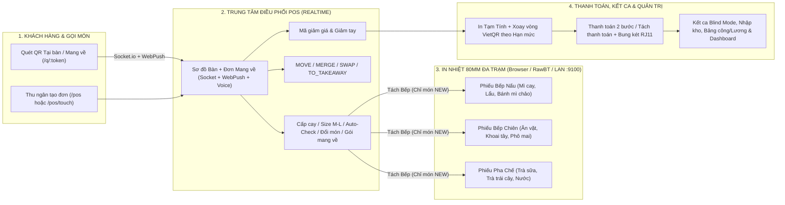

# 🌶️ TÀI LIỆU GIẢI PHÁP & CẨM NANG HƯỚNG DẪN SỬ DỤNG TOÀN DIỆN
## Hệ thống POS & Quản trị Vận hành Thời gian thực — Quán Mì Cay (`fnb-spicy-noodle-system`)

> **Phiên bản tài liệu:** 2.0.0 (Cập nhật đồng bộ toàn hệ thống ngày `2026-11-26` — Stories 01–21)  
> **Mục tiêu tài liệu:** Cung cấp cái nhìn tổng thể về **Giải pháp vận hành khép kín** và **Hướng dẫn thao tác từng bước trực quan nhất** cho Chủ quán, Quản lý cửa hàng, Thu ngân quầy POS (cả giao diện Desktop và POS Cảm ứng kiểu iPOS), Nhân viên phục vụ và Bếp/Pha chế (hỗ trợ giao diện Sáng/Tối tương phản cao và phóng to tỷ lệ hiển thị 80%–150%).

---

## PHẦN I. TỔNG QUAN GIẢI PHÁP & KIẾN TRÚC VẬN HÀNH

### 1. Bài toán Thực tế tại Quán Mì Cay & Giải pháp Đột phá

Quán mì cay quy mô **20–30 bàn, 3+ khu vực chế biến (Bếp Nấu, Bếp Chiên, Pha Chế và trạm mở rộng), 200–600 đơn/ngày** thường gặp 6 điểm nghẽn lớn trong giờ cao điểm. Hệ thống giải quyết triệt để từng điểm nghẽn như sau:

| Điểm nghẽn truyền thống | Giải pháp trên Hệ thống POS Mì Cay | Lợi ích thực tế tại quán |
| :--- | :--- | :--- |
| **1. Khách gọi món phức tạp** *(Chọn cấp cay 0–7, Size M/L, bỏ rau/kim chi, đổi tôm lấy mực, thêm topping, gói mang về từng món)* | **Thực đơn 3 tầng động + Engine Tuỳ chọn Đổi món thông minh (Auto-Check & Substitution)** | Thu ngân & khách quét QR chỉ cần **bỏ tích** món không ăn, hệ thống tự động suy luận món thay thế, gắn Size `(M)/(L)` và in rõ lên phiếu bếp. |
| **2. Chạy giấy tay xuống 3 bếp dễ sót món hoặc nấu trùng** | **Cơ chế Delta Split Đa Trạm Bếp (In nhiệt 80mm tự cắt)** | Chỉ in đúng **các món mới gọi thêm (`NEW`)**, tự động phân rã Combo về đúng Bếp Nấu / Bếp Chiên / Pha Chế, **không bao giờ in trùng** món đã làm. Hỗ trợ in qua Trình duyệt, **Android POS USB (RawBT)** và **LAN ESC/POS `:9100`**. |
| **3. Khách xin xem bill kiểm tra tiền nhưng bấm nhầm thành Thanh toán** | **Tách bạch "In tạm tính (Kèm VietQR động xoay vòng)" vs "Thanh toán 2 bước / Tách thanh toán"** | In tạm tính thoải mái (tự xoay vòng mã QR ngân hàng theo hạn mức Ngày/Tháng/Năm) mà bàn vẫn giữ **Đang phục vụ (`SERVING`)**; chỉ khi xác nhận thu tiền 2 bước mới đóng đơn & bung két tiền `RJ11`. |
| **4. Lệch tiền két cuối ca do lẫn lộn Chuyển khoản QR, tiền chi két và thiếu minh bạch** | **Công thức Kết ca Chuẩn xác + Blind Mode + Bù chênh lệch** | Tự động bóc tách riêng Tiền mặt (`CASH` + phần mặt của `SPLIT`) và trừ phiếu nhập từ két (`CASH_DRAWER`). Tiền chuyển khoản QR không làm sai lệch két; thu ngân đếm tiền theo bảng 9 mệnh giá ở chế độ ẩn số lý thuyết (**Blind Mode**). |
| **5. Dễ bỏ sót đơn khách quét QR trên điện thoại/tablet khi thu ngân bận** | **Cảnh báo Đa kênh (Socket.io + Giọng nói tiếng Việt + Web Push + Tự động huỷ quá hạn) & Bảo mật QR Wi-Fi/GPS** | Báo chuông + đọc giọng nói tiếng Việt + đẩy thông báo Web Push kể cả khi tắt màn hình (có kiểm tra chống báo lại đơn cũ khi tỉnh giấc), kèm khoá Wi-Fi/GPS chống đặt ảo từ xa. |
| **6. Khó thao tác nhanh trên máy POS cảm ứng tại quầy** | **Chế độ POS Cảm ứng Toàn màn hình (`/pos/touch` + Trung tâm Quản lý `/pos/touch/hub`)** | Giao diện kiểu iPOS với sơ đồ 4 tab (**Tất cả / Phòng bàn / Mang về / Lưu tạm**), thanh đáy 4 nút, báo hết món 1 chạm và cấu hình máy in/két tiền ngay tại quầy. |

---

### 2. Sơ đồ Luồng Vận hành Khép kín (End-to-End Workflow)

---

### 3. Danh mục 16 Phân hệ Chức năng & Đường dẫn Truy cập Nhanh

Bạn có thể chuyển nhanh giữa các màn hình bằng **Thanh menu bên trái (Sidebar)**, tổ hợp phím **`Ctrl + K` / `Cmd + K`** (Command Palette — tự lọc theo quyền RBAC), hoặc **Thanh đáy & Hub** trong chế độ **POS Cảm ứng (`/pos/touch`)**:

| STT | Tên Phân hệ | Đường dẫn Desktop | Đường dẫn POS Cảm ứng | Đối tượng chính | Chức năng cốt lõi |
| :-: | :--- | :--- | :--- | :--- | :--- |
| **1** | **Bảng điều khiển Tổng quan** | `/dashboard` | `/pos/touch/dashboard` | Chủ quán, Quản lý, Thu ngân | KPI doanh thu, két tiền, chuyển khoản theo QR, bếp/cấp cay, lợi nhuận ước tính, cảnh báo quá hạn & rủi ro. |
| **2** | **Bán hàng POS (Desktop)** | `/pos` | — | Thu ngân, Quản lý | Màn hình Split-View: sơ đồ bàn + mang về, gọi món nhanh, tách bếp, chuyển/ghép/đổi bàn/chuyển mang về, giảm giá, tạm tính, thanh toán/tách bill. |
| **3** | **POS Cảm ứng & Hub (iPOS)** | — | `/pos/touch`, `/pos/touch/hub`, `/pos/touch/stock-status`, `/pos/touch/printer` | Thu ngân quầy cảm ứng | Toàn màn hình kiosk, 4 tab sơ đồ (**Tất cả / Phòng bàn / Mang về / Lưu tạm**), thanh đáy 4 nút, báo hết món 1 chạm, máy in & mở két RJ11. |
| **4** | **Gọi món QR Khách hàng** | `/q/:token` hoặc `/qr/:token` | *(Mobile khách)* | Khách tại bàn & khách Mang về | Khách tự quét QR gọi món, chọn tuỳ chọn, theo dõi trạng thái realtime, nhận thông báo tức thời (có bảo mật Wi-Fi/GPS). |
| **5** | **Quản trị Thực đơn** | `/menu` | `/pos/touch/menu` | Chủ quán, Quản lý, Thu ngân | Thực đơn 3 tầng động, 4 nhóm tuỳ chọn thông minh, Size M/L, bật/tắt tạm hết món/topping, nhập/xuất Excel, quản lý trạm bếp & danh mục con. |
| **6** | **Quản lý Mã giảm giá** | `/discounts` | `/pos/touch/discounts` | Chủ quán, Quản lý | Tạo mã `%` / số tiền cố định theo toàn đơn, danh mục hoặc món; đặt khung giờ vàng, thứ trong tuần, giới hạn lượt dùng. |
| **7** | **Quản lý Hoá đơn** | `/invoices` | `/pos/touch/invoices` | Thu ngân, Quản lý | Tra cứu lịch sử đơn, xem chi tiết batch/chuyển bàn, in lại hoá đơn, quy trình gửi & duyệt sửa PTTT 2 bước, huỷ đơn ngoại lệ (`VOID`), xuất Excel. |
| **8** | **Nhập hàng Kho** | `/inventory` | `/pos/touch/inventory` | Thu ngân, Quản lý | Ghi nhận phiếu nhập nguyên vật liệu & nhà cung cấp, phân biệt lấy từ **Két tiền mặt (`CASH_DRAWER`)** hay **Quỹ ngoài (`EXTERNAL`)**, xuất Excel. |
| **9** | **Ngân sách & Kết ca** | `/cashflow` | `/pos/touch/cashflow` | Thu ngân, Quản lý | Cấu hình ngân sách đầu ca, đếm tiền 9 mệnh giá (**Blind Mode** với thu ngân), chốt ca, bù chênh lệch, xuất Excel. |
| **10** | **Mã QR Thanh toán** | `/payment-qr` | `/pos/touch/payment-qr` | Chủ quán, Quản lý | Quản lý nhiều tài khoản ngân hàng VietQR, thứ tự ưu tiên xoay vòng, hạn mức Ngày/Tháng/Năm và theo dõi doanh thu từng tài khoản. |
| **11** | **Hồ sơ Nhân sự** | `/employees` | — | Chủ quán, Quản lý | Quản lý nhân sự, chức vụ, chuyên môn, liên kết tài khoản 1-1, tạm ngưng/khôi phục nhân sự, xuất Excel. |
| **12** | **Bảng công / Lịch tuần** | `/schedules` | — | Quản lý, Nhân viên | Ma trận Excel 7 ngày × ca làm việc, chấm công **Đủ ca (`FULL_SHIFT`)** hoặc **Giờ lẻ (`CUSTOM_HOURS`)**, sao chép tuần trước, cảnh báo chưa lưu, xuất Excel. |
| **13** | **Bảng tính Lương** | `/payroll` | — | Chủ quán, Quản lý | Tự động tổng hợp công/giờ từ Bảng công, hỗ trợ `FULL_TIME` & `PART_TIME`, tuỳ chỉnh mức lương/thưởng phạt, xuất Excel. |
| **14** | **Master Data (Dữ liệu gốc)** | `/master-data` | — | Chủ quán, Quản lý | Quản lý 7 danh mục chuẩn hoá không trùng lặp: Danh mục món, Trạm bếp, Chức vụ, Chuyên môn, Nguyên liệu, Nhà cung cấp, ĐVT. |
| **15** | **Phân quyền & Phiên đăng nhập** | `/rbac` | — | Chủ quán (SuperAdmin) | Tách riêng Drawer Thông tin tài khoản & Drawer Phân quyền 14 phân hệ, xem lịch sử phiên/IP, thu hồi phiên từ xa (Single-Session). |
| **16** | **Cài đặt Cửa hàng & Hồ sơ** | `/settings`, `/profile` | `/pos/touch/settings`, `/pos/touch/profile` | Chủ quán (`/settings`), Mọi NV (`/profile`) | Tuỳ biến thương hiệu, logo/favicon, bảng màu, 5 mẫu phiếu in 80mm, danh mục thông báo, thẻ QR, máy in vật lý, bảo mật QR; đổi mật khẩu & khôi phục cài đặt cá nhân. |

---

## PHẦN II. HƯỚNG DẪN SỬ DỤNG CHI TIẾT TỪNG NGHIỆP VỤ

### NGHIỆP VỤ 1: ĐĂNG NHẬP, SINGLE-SESSION & TIỆN ÍCH GIAO DIỆN

#### 1.1. 4 Tài khoản Mẫu Mặc định (Dành cho Khởi tạo / Đào tạo — `seed-data.ts`)
Mật khẩu mặc định chung sau khi seed: **`Password@123`**

| Tên đăng nhập | Vai trò | Phạm vi thao tác chính |
| :--- | :--- | :--- |
| **`superadmin`** | Chủ Cửa Hàng (`Super Admin`) | Toàn quyền tuyệt đối trên tất cả 16 phân hệ, quản trị `/rbac`, xem IP phiên & mở khoá Blind Mode. |
| **`admin`** | Quản Lý Cửa Hàng (`ADMIN`) | Toàn quyền vận hành nghiệp vụ (trừ huỷ hoá đơn đã thu tiền `invoices:void` và thao tác `@SuperAdminOnly`). |
| **`adminview`** | Quản Lý Kiểm Toán (`ADMIN_VIEW`) | Chỉ xem (`view`) và xuất báo cáo Excel (`export`) phục vụ kiểm tra số liệu. |
| **`thungan`** | Thu Ngân Quầy (`CASHIER`) | Bán hàng POS, báo hết món, xem/in lại/gửi duyệt sửa PTTT hoá đơn, nhập hàng, kết ca & bù chênh lệch, xem lịch làm việc. |

#### 1.2. Chính sách Một Phiên Đăng nhập (Single-Session)
- Mỗi tài khoản chỉ đăng nhập đồng thời trên **1 thiết bị/trình duyệt**. Nếu tài khoản đang online ở máy khác, màn hình đăng nhập sẽ hiện hộp thoại cảnh báo để xác nhận **đăng xuất phiên cũ** trước khi vào phiên mới.
- Super Admin có thể xem danh sách phiên online, lịch sử đăng nhập theo IP/thiết bị và bấm **Thu hồi phiên** từ xa trong `/rbac`.

#### 1.3. Tiện ích Giao diện Cá nhân & Bảo toàn khi Đăng xuất
1. **Chế độ Sáng (Light) / Tối (Dark):** Người có quyền `settings.update` hoặc Super Admin chọn trong Cài đặt Cửa hàng, áp dụng cho mọi tài khoản.
2. **Phóng to / Thu nhỏ tỷ lệ hiển thị (`displayScale`):** Tuỳ chỉnh trong Cài đặt Cửa hàng từ `80%` đến `150%` (toàn hệ thống hoặc từng trang riêng, phù hợp nhân sự lớn tuổi hoặc màn hình độ phân giải cao).
3. **Cấu hình cửa hàng và cá nhân (Hard Invariant 9):** Theme, tỉ lệ hiển thị 80–150% và thứ tự menu/nhóm áp dụng chung từ Cài đặt Cửa hàng cho mọi tài khoản, kể cả điện thoại và POS cảm ứng. Các giá trị cá nhân cũ vẫn được giữ nhưng không ghi đè. Độ rộng cột, độ rộng/thu gọn Sidebar và bật/tắt loa báo đơn QR vẫn lưu theo tài khoản. Đăng xuất xoá dữ liệu nghiệp vụ và phiên đăng nhập, giữ nguyên preferences; Hồ sơ có nút **Đặt lại loa và thanh bên**.
4. **QR khách:** Theme theo cấu hình QR của quán; chế độ `system` theo giao diện hệ điều hành, không có nút đổi theme riêng.
5. **Máy in và két tiền:** Chỉ Super Admin chỉnh hoặc khôi phục cấu hình phần cứng tại Cài đặt và POS cảm ứng. Nhân viên vẫn in bằng cấu hình đã lưu và mở két theo quyền hiện có. Cấu hình lưu riêng theo origin/profile trình duyệt, giữ khi logout/đổi tài khoản và đồng bộ giữa các tab; không quản lý từ xa.
6. **Đồng bộ:** Cấu hình và nội dung thông báo cập nhật khi kết nối lại Socket, quay lại tab, online và mỗi 60 giây khi tab ở foreground. Offline giữ cache. Draft đang sửa được giữ; nếu người khác lưu trước, dùng xử lý xung đột 409 để tải lại.

---

### NGHIỆP VỤ 2: QUẢN TRỊ THỰC ĐƠN 3 TẦNG ĐỘNG & TUỲ CHỌN MÓN (`/menu`)

#### 2.1. Cấu trúc Phân cấp Thực đơn 3 Tầng
- **Tầng 1 — Khu vực Bếp (`Station`):** `Bếp nấu` (`BEP_NAU`), `Bếp chiên` (`BEP_CHIEN`), `Pha chế` (`PHA_CHE`), `Combo` (`COMBO`), hoặc các trạm vật lý mở rộng (`BEP_*`) cấu hình tại nút **`Khu vực bếp`**.
- **Tầng 2 — Danh mục con (`MENU_CATEGORY`):** Tạo tại nút **`Danh mục con`** (VD: `Mì Cay`, `Bánh Mì Chảo`, `Trà Sữa`, `Trà Trái Cây`, `Món Chiên Ăn Vặt`...) gắn với khu vực bếp mặc định.
- **Tầng 3 — Sản phẩm & Mô tả phụ (`Subtitle`):** Tên món, mô tả phụ hiển thị trong ngoặc (VD: `Ngao, tôm, mực`), đơn giá gốc, trạng thái `Đang bán / Tạm hết` và danh sách nhóm tuỳ chọn.

#### 2.2. Các Nhóm Tuỳ Chọn Thông Minh
| Loại Nhóm Tuỳ Chọn | Cơ chế cấu hình | Hành vi trên POS & QR |
| :--- | :--- | :--- |
| **1. Cấp độ cay (0–7)** | `maxSelect = 1`, `Bắt buộc chọn` | Bắt buộc chọn 1 cấp độ cay trước khi thêm vào đơn. |
| **2. Size Đồ uống (M / L)** | Tự động áp cho các nhóm đồ uống (`Size M: +0đ`, `Size L: +5.000đ`) | Hiển thị gọn `Tên món (M)` / `Tên món (L)` trên giỏ hàng và phiếu in. |
| **3. Đồ ăn mặc định (0đ)** | Bật **`Auto bật`** (`is_auto_select`) | Tự tích sẵn tất cả; khi khách không ăn món nào chỉ cần bỏ tích → phiếu bếp in `Không Rau, Không Kim chi`. |
| **4. Đồ ăn chính (Đổi món)** | Bật **`Auto bật`** + **`Logic đổi món chính`** (`allow_substitution`) | Bỏ tích 1 món (VD: Tôm) tự đổi sang món thay thế mặc định (Mực); bỏ 2/3 món tự khoá sang món duy nhất còn lại; chặn bỏ hết cả 3. |
| **5. Topping thêm (+Giá)** | Không bật Auto bật, đặt `extraPrice > 0` | Tích chọn cộng thẳng vào đơn giá; có công tắc **Tạm hết** riêng cho từng topping. |

- Hỗ trợ **Nhập thực đơn hàng loạt từ Excel** (`Import Excel`) và **Xuất Excel** danh sách món.

---

### NGHIỆP VỤ 3: BÁN HÀNG POS DESKTOP (`/pos`) & POS CẢM ỨNG (`/pos/touch`)

#### 3.1. Chế độ POS Cảm ứng Toàn màn hình kiểu iPOS (`/pos/touch/*`)
- Chuyển nhanh từ Navbar hoặc đăng nhập thẳng vào `/pos/touch` trên máy tính bảng / máy POS `iMin D3-505`.
- **Sơ đồ 4 Tab trên thanh trên cùng:**
  - **Tất cả (Mặc định):** Ô **`+ Đơn mang về mới`**, một thẻ **`Giỏ chưa gán bàn`**, các thẻ **`Mang về #NN`** đang phục vụ rồi đến `Bàn 01`. Thẻ `Giỏ chưa gán bàn` chỉ xuất hiện một lần.
  - **Phòng bàn:** Chỉ hiển thị lưới bàn vật lý (`Bàn 01`..`Bàn N`).
  - **Mang về:** Ô `+ Đơn mang về mới`, một thẻ `Giỏ chưa gán bàn` và danh sách đơn mang về đang mở.
  - **Lưu tạm:** Thẻ `Giỏ chưa gán bàn` ở đầu lưới để bắt đầu giỏ mới, sau đó là danh sách các giỏ đã lưu. Thẻ tạo giỏ cũng có một lần xuất hiện ở tab này.
- **Thanh điều hướng đáy 4 nút (`Bán hàng · Hoá đơn · Kết ca · Quản lý`):** Tự ẩn khi vào màn gọi món/tính tiền (`TouchOrderScreen`). Bấm **Quản lý** mở **Hub (`/pos/touch/hub`)** gồm 4 thẻ nổi bật (**Tổng quan**, **Cài đặt**, **Mã giảm giá**, **Thực đơn**) và lưới ô quầy (**Báo hết món 1 chạm**, **Máy in & Két tiền**, **Hoá đơn**, **Kết ca**, **Nhập hàng**, **Mã QR TT**, **Hồ sơ**).

#### 3.2. Trạng thái Bàn, Gọi món, Tách Bếp & Thao tác Bàn
- **Màu trạng thái bàn:** Trống (`AVAILABLE`) · Chờ duyệt đơn QR (`PENDING`, nhấp nháy kèm chuông/giọng nói/Web Push) · Đang phục vụ (`OCCUPIED`).
- **Tách Bếp (`Tách đơn`):** Chỉ in các món trạng thái `NEW` về đúng từng trạm bếp (phân rã `COMBO`), đánh dấu lượt gọi (`Lượt 1`, `GỌI THÊM - LƯỢT 2`), kèm nhãn `[MANG VỀ]` nếu từng món được đánh dấu gói mang về (`is_takeaway`). Có nút **In lại phiếu bếp** riêng khi cần.
- **Huỷ / Sửa món:** Món chưa in (`NEW`) sửa/xoá trực tiếp không tốn giấy; món đã in (`PRINTED`) khi huỷ sẽ tự in **Phiếu báo huỷ món** xuống trạm bếp tương ứng.
- **4 Thao tác Bàn (`Chuyển / Ghép / Đổi bàn / Mang về`):**
  1. **Chuyển bàn (`MOVE`):** Bàn → Bàn trống, hoặc **Mang về → Bàn trống**. Khi chuyển đơn Mang về vào bàn, các món cũ được bỏ cờ `[MANG VỀ]`; trạng thái `PRINTED` vẫn giữ nguyên.
  2. **Ghép bàn (`MERGE`):** Bàn → Bàn đang ăn, hoặc **Mang về → Bàn đang ăn**. Các món từ đơn Mang về được bỏ cờ `[MANG VỀ]`; trạng thái `PRINTED` vẫn giữ nguyên.
  3. **Đổi bàn (`SWAP`):** Hoán đổi 2 bàn đang có khách (không áp dụng cho đơn Mang về).
  4. **Chuyển sang Mang về (`TO_TAKEAWAY`):** Giải phóng bàn đang ngồi và cấp số `Mang về #NN` cho đơn đó.
  - Nếu đơn đã có món `PRINTED`, hệ thống tự in **Phiếu Thông báo Đổi bàn** cho bếp và đồng bộ tức thời điện thoại khách (`order:session_redirected`). Với món từ đơn Mang về, phiếu bếp ở lượt tách sau bỏ nhãn `[MANG VỀ]` và giữ ghi chú tuyến chuyển như `Chuyển từ Mang về #02 sang Bàn 22`.

#### 3.3. Giỏ tạm POS dùng chung giữa các máy
- Có thể bắt đầu giỏ từ một bàn trống, từ **`+ Đơn mang về mới`**, hoặc chọn **`Giỏ chưa gán bàn`** để gọi món trước rồi chọn bàn/Mang về sau.
- Bấm **`Lưu tạm`** để lưu giỏ vào danh sách giỏ tạm của POS. Giỏ đã lưu xuất hiện trên các máy POS khác; thu ngân có thể mở lại, tiếp tục gọi món hoặc xoá.
- Giỏ tạm không tạo hoá đơn, không chiếm bàn, không gửi phiếu bếp và không thể thanh toán. Khi bấm gửi, hệ thống dùng giá món hiện hành. Bàn phải còn trống; nếu bàn đã có khách hoặc món không còn hợp lệ, giỏ vẫn được giữ để sửa/đổi đích.
- Draft được đồng bộ bằng thông báo staff POS. Khách QR không xem được danh sách giỏ tạm.
- Trong tab **Lưu tạm**, các giỏ hiển thị thành ô vuông. Chạm vào ô để mở lại; nút thùng rác riêng dùng để xóa giỏ. Nút này yêu cầu quyền **Xóa giỏ lưu tạm** (`pos.deleteDrafts`), được cấp mặc định cho thu ngân; quyền này không cho phép hủy đơn đã xác nhận.
- Thẻ **Giỏ chưa gán bàn** có cùng hành vi ở các tab **Tất cả**, **Mang về** và **Lưu tạm**: mở một giỏ mới để gọi món trước, rồi chọn bàn hoặc Mang về sau. Tab **Phòng bàn** chỉ hiển thị bàn vật lý.
- Trước **Xác nhận tạo đơn**, bấm **Bỏ toàn bộ giỏ** rồi xác nhận để bỏ tất cả món cùng lúc. Với giỏ đã lưu, hệ thống chỉ xóa nội dung trên máy sau khi server xóa thành công đúng phiên bản. Nếu lỗi mạng hoặc giỏ đã được sửa ở máy khác, món và bàn đã chọn vẫn được giữ lại. Xóa giỏ không giải phóng hoặc thay đổi bàn đang có đơn QR.

---

### NGHIỆP VỤ 4: GIẢM GIÁ, TẠM TÍNH XOAY VÒNG VIETQR & THANH TOÁN

1. **Áp Mã giảm giá / Giảm giá tay:**
   - Chọn mã hợp lệ từ danh sách gợi ý (`applicable-discounts`) hoặc nhập mã; hệ thống tự kiểm tra điều kiện đơn tối thiểu, khung giờ, thứ trong tuần, phạm vi món/danh mục và lượt dùng.
   - **Giảm giá thủ công (Giảm tay):** Chỉ tài khoản được cấp quyền riêng **`pos:manualDiscount`** mới sử dụng được.
2. **In tạm tính & Tạm tính tách đơn (`GIỮ NGUYÊN SERVING`):**
   - Bấm **`In tạm tính`** (hoặc chọn món để **Tạm tính tách đơn**): hệ thống tự động duyệt danh sách tài khoản ngân hàng đang bật trong **`/payment-qr`** theo thứ tự ưu tiên, chọn mã QR chưa chạm hạn mức Ngày/Tháng/Năm để sinh mã VietQR Napas247 chính xác số tiền sau giảm giá. Nếu tất cả đều vượt hạn mức, vẫn in mã ưu tiên #1 kèm cảnh báo để không gián đoạn bán hàng.
3. **Thanh toán 2 bước & Tách thanh toán (`CHUYỂN SANG PAID`):**
   - Chọn **`Tiền mặt (CASH)`**, **`Chuyển khoản QR (TRANSFER)`**, hoặc **`Kết hợp (SPLIT)`** (nhập cả tiền mặt và chuyển khoản sao cho tổng khớp 100% hoá đơn).
   - Hỗ trợ **Tách thanh toán (`split-checkout`)**: tách một nhóm món trong bàn ra thanh toán thành hoá đơn riêng đã `PAID`, các món còn lại giữ nguyên trên bàn đang phục vụ.
   - Khi chốt thanh toán tiền mặt (nếu bật cấu hình & có quyền `pos:openCashDrawer`), máy in tự gửi xung `RJ11` bung két tiền.

---

### NGHIỆP VỤ 5: KHÁCH QUÉT QR GỌI MÓN, BẢO MẬT QR & CẢNH BÁO REALTIME

- **Đường dẫn QR rút gọn:** Hỗ trợ `/q/:token` (ngắn gọn, dễ quét) và `/qr/:token` cho cả **QR Bàn vật lý** và **QR Mang về** dán tại quầy. Có nút xoay mã QR từng bàn/mang về và xuất ảnh thẻ QR để in.
- **Bảo mật QR (Wi-Fi / GPS):** Quản lý có quyền `pos:qrSecurity` bật khoá theo IP Wi-Fi quán và/hoặc bán kính GPS trong `/settings` để chặn đơn đặt từ xa.
- **Cảnh báo Đa kênh & Tự động huỷ quá hạn:**
  - Khi khách gửi đơn QR mới hoặc gọi thêm món, POS đổ chuông, phát giọng nói tiếng Việt và gửi **Web Push** tới điện thoại nhân viên đang đăng ký (có kiểm tra `qr-pending-check` để không báo lại đơn đã xử lý).
  - Nếu đơn QR `PENDING` hoặc món gọi thêm không được duyệt sau thời gian cấu hình, hệ thống nhắc định kỳ và tự động huỷ quá hạn, thông báo đồng thời cho cả khách và thu ngân.

---

### NGHIỆP VỤ 6: HOÁ ĐƠN, NHẬP KHO, KẾT CA BLIND MODE & MÃ QR THANH TOÁN

- **Quản lý Hoá đơn (`/invoices`):**
  - Bộ lọc kép theo khoảng ngày + từ khoá/trạng thái/PTTT, in lại hoá đơn, xuất Excel.
  - **Sửa PTTT 2 bước sau thanh toán:** Thu ngân (`invoices:update`) gửi yêu cầu đổi PTTT (VD: nhầm `CASH` sang `TRANSFER`) → Quản lý (`invoices:approve`) nhận cảnh báo trên Dashboard/Hoá đơn để phê duyệt hoặc từ chối.
  - **Huỷ hoá đơn (`VOID`):** Chỉ tài khoản có quyền `invoices:void`, bắt buộc nhập lý do ≥ 10 ký tự; tự động loại trừ khỏi Kết ca và hạn mức Mã QR.
- **Nhập hàng Kho (`/inventory`):**
  - Chọn/tạo nhanh Nguyên liệu, Nhà cung cấp và ĐVT qua Smart Combobox tự chuẩn hoá MDM; phân biệt nguồn **`CASH_DRAWER`** (trừ vào tiền mặt két) và **`EXTERNAL`** (quỹ ngoài, không trừ két).
- **Ngân sách & Kết ca (`/cashflow`):**
  - Công thức bất biến: `expected_cash = opening_budget + Thu Tiền mặt (CASH + phần mặt SPLIT) - Nhập hàng từ Két (CASH_DRAWER)`.
  - **Blind Mode:** Thu ngân chỉ thấy bảng đếm 9 mệnh giá để nhập số tiền thực đếm khách quan; sau khi chốt hệ thống hiển thị chênh lệch (`MATCHED` / `SURPLUS` / `SHORTAGE`), tiền giữ lại két (`opening_budget`) và tiền nộp chủ (`cashToHandOver`). Khi lệch bắt buộc ghi lý do; có chức năng **Bù chênh lệch** (`cashflow:compensate`).
- **Mã QR Thanh toán (`/payment-qr`):**
  - Thêm/sửa/sắp xếp thứ tự ưu tiên tài khoản ngân hàng, đặt hạn mức Ngày/Tháng/Năm, xem doanh thu thực tế và danh sách hoá đơn theo từng tài khoản.

---

### NGHIỆP VỤ 7: NHÂN SỰ, BẢNG CÔNG TUẦN, TÍNH LƯƠNG, MASTER DATA & PHÂN QUYỀN

- **Hồ sơ Nhân sự (`/employees`):** Quản lý hồ sơ, tạm ngưng/khôi phục nhân sự, xem tài khoản liên kết 1-1 ngay trên bảng hoặc tạo tài khoản kèm hồ sơ nhân sự mới.
- **Bảng công / Lịch tuần (`/schedules`):** Ma trận 7 ngày × ca làm việc, chọn nhân viên làm **Đủ ca (`FULL_SHIFT`)** hoặc nhập **Giờ lẻ (`CUSTOM_HOURS`)**; có nút **Sao chép từ tuần trước**, cảnh báo rời trang khi chưa lưu và xuất Excel.
- **Bảng tính Lương (`/payroll`):** Tự động lấy dữ liệu công/giờ từ Bảng công theo khoảng ngày chọn. Hỗ trợ nhân viên **Full-time** (lương cơ bản / công chuẩn) và **Part-time** (đơn giá theo giờ), cấu hình định mức chung (`payroll:config`), chỉnh sửa/ghi đè công-lương-thưởng/phạt từng người (`payroll:update`) và xuất Excel.
- **Master Data (`/master-data`):** Quản trị tập trung **7 danh mục chuẩn hoá** (`MENU_CATEGORY`, `KITCHEN_STATION`, `POSITION`, `SPECIALTY`, `INGREDIENT`, `SUPPLIER`, `UNIT`) — tự động chuẩn hoá chữ hoa đầu từ & chống trùng không dấu.
- **Phân quyền (`/rbac`):** Tách rõ 2 bảng bên phải:
  - **Drawer Thông tin tài khoản:** Sửa username, nhãn vai trò hiển thị (`roleLabel`), liên kết nhân sự, khoá/mở tài khoản.
  - **Drawer Phân quyền:** Bật/tắt quyền chi tiết trên **14 phân hệ**, đẩy quyền realtime xuống thiết bị nhân viên ngay lập tức; đặt lại mật khẩu và quản lý phiên đăng nhập/IP.
- **Nhật ký Kiểm toán (`Audit Logs`):** Mỗi màn hình quản trị đều có nút mở lịch sử thao tác riêng theo phân hệ (13 module) để truy vết ai làm gì, lúc nào.

---

### NGHIỆP VỤ 8: CÀI ĐẶT CỬA HÀNG ĐỘNG (`/settings`) & MÁY IN VẬT LÝ

Tại `/settings` (quyền `settings:view` / `settings:update`), chủ quán có thể tuỳ biến toàn bộ quán mà không cần sửa code:
1. **Thông tin & Thương hiệu:** Tên quán, mô tả, tải lên `Logo`, `Favicon`, `QR Logo`.
2. **Giao diện & Màu sắc:** Màu thương hiệu, màu chữ chính, màu chữ nhấn, màu đơn giá riêng cho Light/Dark, theme mặc định, tỷ lệ hiển thị (`80%–150%`), đổi tên/thứ tự nhóm menu Sidebar và tiêu đề từng trang.
3. **Phiếu in 80mm & Phần cứng:**
   - Tuỳ chỉnh đầy đủ **5 mẫu phiếu in** (`Phiếu tạm tính`, `Hoá đơn thanh toán`, `Phiếu tách bếp`, `Phiếu huỷ món`, `Phiếu đổi bàn`): tiêu đề, chân trang, cỡ chữ (`6pt–16pt`), ẩn/hiện từng khối thông tin, chọn danh mục hiện giá trên phiếu bếp.
   - Chọn 1 trong 3 chế độ in vật lý: **Trình duyệt (`--kiosk-printing`)**, **Cáp USB Android POS (`RawBT`)**, hoặc **LAN ESC/POS (`IP:9100`)**, kèm nút **In phiếu kiểm tra 80mm** và **Test bung két tiền (RJ11)**.
4. **Danh mục Thông báo & Giọng nói QR:** Chỉnh nội dung thông báo hiển thị trên POS/trang QR, cấu hình nhắc đơn QR quá hạn và tự động huỷ đơn QR.
5. **Thẻ QR & Bảo mật QR:** Tuỳ biến mẫu thẻ QR in dán bàn/mang về và thiết lập khoá Wi-Fi/GPS.

---

## PHẦN III. CÂU HỎI THƯỜNG GẶP & XỬ LÝ NHANH TẠI QUẦY (FAQ)

| Tình huống tại quán | Cách xử lý ngay trên hệ thống |
| :--- | :--- |
| **1. Khách gọi "Mì cay hải sản cấp 2, không ăn rau, đổi ngao sang mực, thêm bò Mỹ, 1 trà đào size L mang về"** | 1. Chọn **Mì cay hải sản** → tích **Cấp 2**, bỏ tích **Rau**, bỏ tích **Ngao** (tự hiện `↳ Thay thế bằng Mực`), tích thêm **Bò Mỹ (+10k)**. 2. Chọn **Trà đào** → tích **Size L (+5k)** và bật cờ **Gói mang về** cho dòng món đó → bấm **Tách bếp**. |
| **2. Khách đặt Mang về #03 nhưng đổi ý muốn vào ngồi Bàn 05 (hoặc gộp với bạn ở Bàn 08)** | Chọn đơn **Mang về #03** → bấm **Chuyển / Ghép / Đổi bàn** → chọn **Chuyển bàn (`MOVE`)** vào Bàn 05 đang trống hoặc **Ghép bàn (`MERGE`)** vào Bàn 08 đang ngồi. |
| **3. Khách bàn 04 chỉ muốn trả tiền trước phần đồ uống của 1 bạn về sớm** | Mở hoá đơn Bàn 04 → chọn **Tách thanh toán** (hoặc **Tạm tính tách đơn**) → chọn đúng các món cần trả → chốt thanh toán tạo hoá đơn con `PAID`, các món còn lại giữ nguyên trên Bàn 04. |
| **4. Thu ngân chọn nhầm PTTT Tiền mặt thay vì Chuyển khoản sau khi đã đóng đơn** | Vào **Hoá đơn (`/invoices`)** → mở chi tiết đơn → bấm **Sửa PTTT** chọn `Chuyển khoản` và ghi lý do → Quản lý (`invoices:approve`) vào bấm **Duyệt**, số liệu Kết ca & Mã QR tự động cập nhật lại chính xác. |
| **5. Hôm nay quán hết Mực hoặc hết món trong giờ cao điểm** | Trên máy POS cảm ứng vào **Quản lý → Báo hết món 1 chạm (`/pos/touch/stock-status`)** (hoặc `/menu` trên Desktop) gạt tắt món/topping. POS và trang QR khách sẽ khoá món ngay lập tức qua realtime. |
| **6. Triển khai máy POS Android `iMin D3-505` cắm cáp USB vào máy in nhiệt `iPOS.vn iTP6` & két tiền `RJ11`** | 1. Cắm cáp USB từ **Cổng số 3 (USB-B)** máy in `iTP6` vào cổng USB của `iMin D3-505`, dây két tiền cắm vào **Cổng số 5 (RJ11 24V)**. 2. Cài **RawBT Print Service** trên `iMin D3-505`, chọn kết nối `USB` tới `iTP6` (`80mm / 576 dots`). 3. Trên Web POS vào **`/pos/touch/printer`** (hoặc **`/settings` → Tab `Phiếu in`**), chọn **`Cáp USB trực tiếp trên Android POS (RawBT)`** (hoặc **`Dây mạng LAN :9100`** nếu cắm cổng Ethernet số 4) rồi bấm **In phiếu kiểm tra 80mm** và **Test bung két tiền (RJ11)**. |
