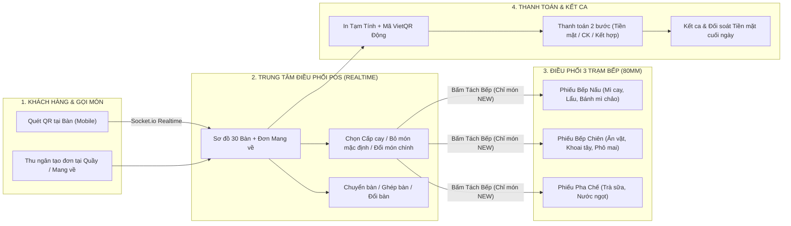

# 🌶️ TÀI LIỆU GIẢI PHÁP & CẨM NANG HƯỚNG DẪN SỬ DỤNG TOÀN DIỆN
## Hệ thống POS & Quản trị Vận hành Thời gian thực — Quán Mì Cay Sơn Bảo

> **Mục tiêu tài liệu:** Cung cấp cái nhìn tổng thể về **Giải pháp vận hành khép kín** và **Hướng dẫn thao tác từng bước trực quan nhất** cho Chủ quán, Quản lý cửa hàng, Thu ngân quầy POS, Nhân viên phục vụ và Bếp/Pha chế (bao gồm cả nhân sự lớn tuổi nhờ giao diện Sáng/Tối tương phản cao WCAG AAA).

---

## PHẦN I. TỔNG QUAN GIẢI PHÁP & KIẾN TRÚC VẬN HÀNH

### 1. Bài toán Thực tế tại Quán Mì Cay & Giải pháp Đột phá

Quán mì cay quy mô **20–30 bàn, 3 khu vực chế biến (Bếp Nấu, Bếp Chiên, Pha Chế), 200–600 đơn/ngày** thường gặp 5 điểm nghẽn lớn trong giờ cao điểm. Hệ thống giải quyết triệt để từng điểm nghẽn như sau:

| Điểm nghẽn truyền thống | Giải pháp trên Hệ thống POS Mì Cay Sơn Bảo | Lợi ích thực tế tại quán |
| :--- | :--- | :--- |
| **1. Khách gọi món phức tạp** *(Chọn cấp cay 1–7, bỏ rau/kim chi, đổi tôm lấy mực, thêm topping)* | **Thực đơn 3 tầng động + Engine Tuỳ chọn Đổi món thông minh (Auto-Check & Substitution)** | Thu ngân & khách quét QR chỉ cần **bỏ tích** món không ăn, hệ thống tự động tính toán món thay thế và in rõ lên phiếu bếp. |
| **2. Chạy giấy tay xuống 3 bếp dễ sót món hoặc nấu trùng** | **Cơ chế Delta Split 3 Bếp (Tách bếp thông minh 80mm)** | Chỉ in đúng **các món mới gọi thêm (`NEW`)**, tự động phân rã Combo về đúng Bếp Nấu / Bếp Chiên / Pha Chế, **không bao giờ in trùng** món đã làm. |
| **3. Khách xin xem bill kiểm tra tiền nhưng bấm nhầm thành Thanh toán** | **Tách bạch "In tạm tính (Kèm VietQR động)" vs "Thanh toán 2 bước"** | In tạm tính thoải mái mà bàn vẫn giữ trạng thái **Đang ngồi (`SERVING`)**; chỉ khi xác nhận thu tiền 2 bước mới giải phóng bàn. |
| **4. Lệch tiền két cuối ca do lẫn lộn tiền Chuyển khoản QR và Tiền mặt** | **Công thức Kết ca Két tiền mặt Chuẩn xác (Cashflow Settlement)** | Tự động bóc tách riêng Tiền mặt (`CASH` + phần tiền mặt của đơn `SPLIT`) và trừ phiếu chi lấy từ két (`CASH_DRAWER`). Tiền chuyển khoản QR không làm sai lệch két. |
| **5. Khó dùng trên điện thoại / máy tính bảng hoặc chói mắt khi đứng quầy lâu** | **Giao diện Responsive Đa thiết bị + Chế độ Sáng/Tối thân thiện thị giác** | Chữ rõ nét, nút bấm lớn >= 44px, thông báo góc phải trên tự đóng sau 3.5 giây, phù hợp mọi lứa tuổi. |

---

### 2. Sơ đồ Luồng Vận hành Khép kín (End-to-End Workflow)

---

### 3. Danh mục 9 Phân hệ Chức năng & Đường dẫn Truy cập Nhanh

Bạn có thể chuyển nhanh giữa các màn hình bằng **Thanh menu bên trái (Sidebar)** hoặc nhấn tổ hợp phím **`Ctrl + K`** để mở hộp thoại Tìm kiếm màn hình nhanh:

| STT | Tên Phân hệ | Đường dẫn | Đối tượng sử dụng chính | Chức năng cốt lõi |
| :-: | :--- | :--- | :--- | :--- |
| **1** | **Bán hàng POS** | `/pos` | Thu ngân, Phục vụ, Quản lý | Quản lý sơ đồ 30 bàn + đơn Mang về, gọi món nhanh, tách 3 bếp, chuyển/ghép/đổi bàn, in tạm tính VietQR, thanh toán. |
| **2** | **Gọi món QR Tại bàn** | `/qr/:token` | Khách hàng tại bàn | Khách tự quét mã QR trên bàn bằng điện thoại để chọn món, chọn cấp cay, đổi món chính và gửi thẳng về quầy POS. |
| **3** | **Quản trị Thực đơn** | `/menu` | Chủ quán, Quản lý | Thiết lập phân cấp thực đơn 3 tầng động, thêm/sửa món, bật/tắt hết món, cấu hình nhóm tuỳ chọn & đổi món thông minh. |
| **4** | **Quản lý Hoá đơn** | `/invoices` | Thu ngân, Quản lý | Tra cứu lịch sử đơn hàng, xem chi tiết món, in lại hoá đơn 80mm, huỷ hoá đơn sai sót (có ghi lý do). |
| **5** | **Nhập hàng Kho** | `/inventory` | Thu ngân, Quản lý | Ghi nhận phiếu nhập nguyên vật liệu trong ca, phân biệt lấy tiền từ **Két tiền mặt** hay **Nguồn ngoài**. |
| **6** | **Ngân sách & Kết ca** | `/cashflow` | Thu ngân, Quản lý | Khai báo tiền lẻ đầu ca, tự động tính tiền mặt lý thuyết trong két, đếm tiền thực tế và chốt ca cuối ngày. |
| **7** | **Hồ sơ Nhân sự** | `/employees` | Quản lý, Chủ quán | Quản lý danh sách nhân viên, vị trí công việc, chuyên môn phục vụ/bếp và cấp tài khoản đăng nhập. |
| **8** | **Lịch làm việc Tuần** | `/schedules` | Quản lý, Nhân viên | Xếp lịch ca Sáng / Chiều / Tối cho cả tuần theo giao diện bảng Excel trực quan (chọn nhân viên ngay trên từng ô). |
| **9** | **Master Data & Phân quyền** | `/master-data`, `/rbac` | Chủ quán (SuperAdmin) | Quản lý dữ liệu chuẩn hoá (Danh mục thực đơn, Nguyên liệu, Nhà cung cấp, Vị trí...) và bật/tắt quyền chi tiết cho từng nhân viên. |

---

## PHẦN II. HƯỚNG DẪN SỬ DỤNG CHI TIẾT TỪNG NGHIỆP VỤ

### NGHIỆP VỤ 1: ĐĂNG NHẬP & LÀM QUEN GIAO DIỆN CHUNG

#### 1.1. Tài khoản Mặc định (Dành cho Khởi tạo / Đào tạo)
- **Tài khoản Chủ quán (Full quyền SuperAdmin):**
  - Tên đăng nhập: `superadmin`
  - Mật khẩu: `Password@123`
- **Tài khoản Thu ngân mẫu:**
  - Tên đăng nhập: `cashier01`
  - Mật khẩu: `Password@123`

#### 1.2. Tiện ích Giao diện Thân thiện Người dùng (Kể cả Người lớn tuổi)
1. **Chuyển đổi Giao diện Sáng (Light Mode) / Tối (Dark Mode):**
   - Bấm vào biểu tượng **Mặt trời / Mặt trăng** ở góc trên bên phải thanh Header.
   - **Chế độ Sáng (Warm Ivory):** Nền kem ấm dịu mắt, chống chói lóa dưới đèn huỳnh quang tại quán.
   - **Chế độ Tối (Deep Slate):** Tương phản cao, tiết kiệm pin cho máy tính bảng/điện thoại ca tối.
2. **Hệ thống Thông báo (Toast Notification) Góc Phải Trên:**
   - Mọi thao tác thành công (màu xanh lá), cảnh báo (màu vàng hổ phách) hoặc lỗi (màu đỏ) đều xuất hiện rõ ràng ở **góc trên bên phải**, có thanh đếm ngược và tự động đóng sau **3.5 giây** (riêng thông báo lỗi giữ **5 giây** để kịp đọc).
3. **Lưu giữ Thói quen Cá nhân (UI Preferences):**
   - Độ rộng các cột bảng dữ liệu, trạng thái đóng/mở thanh menu bên trái và chế độ Sáng/Tối đều được hệ thống **tự động ghi nhớ** ngay cả khi bạn đăng xuất.

---

### NGHIỆP VỤ 2: QUẢN TRỊ THỰC ĐƠN 3 TẦNG ĐỘNG & CẤU HÌNH TUỲ CHỌN MÓN (`/menu`)

#### 2.1. Hiểu rõ Cấu trúc Phân cấp Thực đơn 3 Tầng
Hệ thống tổ chức thực đơn theo đúng luồng vận hành thực tế của quán:
- **Tầng 1 — Khu vực Bếp (Station):** Quyết định món ăn sẽ in ra máy in nhiệt của trạm nào khi bấm *Tách Bếp*:
  - `Bếp nấu` (`BEP_NAU`): Mì cay, Bánh mì chảo, Lẩu...
  - `Bếp chiên` (`BEP_CHIEN`): Khoai tây chiên, Phô mai que, Cá viên chiên...
  - `Pha chế` (`PHA_CHE`): Trà đào, Nước ngọt, Trà sữa...
  - `Combo` (`COMBO`): Gói nhiều món gộp lại (khi tách bếp sẽ tự động bung về đúng 3 trạm thực tế).
- **Tầng 2 — Danh mục con (MDM Category):** Các nhóm món do bạn tự đặt tên trong từng bếp (Ví dụ trong *Bếp nấu* có: `+ Mì Cay`, `+ Bánh Mì Chảo`, `+ Lẩu & Món Nóng`).
- **Tầng 3 — Sản phẩm & Mô tả phụ (Subtitle động):**
  - Tên món gốc: Ví dụ **`Mì cay hải sản`**
  - Mô tả phụ (Subtitle hiển thị trong ngoặc): Ví dụ **`(Ngao, tôm, mực)`** hoặc **`(Trứng ốp la, pate, xúc xích, bò sốt tiêu)`**.

#### 2.2. Các bước Tạo Danh mục con mới (Tầng 2)
1. Tại màn hình **Quản trị Thực đơn (`/menu`)**, bấm nút **`Danh mục con`** ở góc trên bên phải.
2. Nhập tên danh mục con (VD: `Mì Cay`, `Bánh Mì Chảo`, `Lẩu Tokbokki`) và chọn **Khu vực bếp mặc định** (`Bếp nấu` / `Bếp chiên` / `Pha chế`).
3. Bấm **`Thêm danh mục`** — hệ thống tự động chuẩn hoá chữ hoa đầu từ và chống trùng lặp.

#### 2.3. Các bước Thêm / Sửa Món ăn & Cấu hình 4 Nhóm Tuỳ Chọn Điển hình
1. Bấm nút **`+ Thêm món vào Thực đơn`** (hoặc bấm biểu tượng **Cây bút** ở dòng sản phẩm muốn sửa).
2. **Phần 1 — Thông tin gốc:**
   - Chọn **Tầng 1 (Khu vực Bếp)** và **Tầng 2 (Danh mục con)**.
   - Nhập **Tên sản phẩm** (VD: `Mì cay hải sản`), **Mô tả phụ / Subtitle động** (VD: `Ngao, tôm, mực`) và **Đơn giá gốc** (VD: `79000`).
3. **Phần 2 — Cấu hình Nhóm Tuỳ Chọn Trong Sản Phẩm:**
   Bạn có thể bấm **`+ Tự thêm nhóm tuỳ chọn`** để tự thiết kế bất kỳ nhóm nào, hoặc bấm **4 nút Chèn mẫu nhanh 1 chạm**:

| Loại Nhóm Tuỳ Chọn | Cách thiết lập các cờ trong nhóm | Hành vi trên màn hình POS & QR |
| :--- | :--- | :--- |
| **1. Cấp độ cay** *(Cấp 1 → Cấp 7)* | • Số lượng chọn tối đa: `1` • Tích chọn: `Bắt buộc chọn` | Nhân viên/khách bắt buộc tích chọn 1 cấp độ cay trước khi thêm món vào đơn. |
| **2. Đồ ăn mặc định (0đ)** *(Tôm viên, Xúc xích, Ngô, Rau, Nấm kim châm, Kim chi)* | • Tích chọn: **`Auto bật (Tự động tích sẵn tất cả khi mở món)`** | Khi bấm vào món, cả 6 ô đều **tự động được tích chọn sẵn**. Nếu khách dặn *"Không ăn rau, không kim chi"*, thu ngân chỉ cần **bỏ tích** ô *Rau* và *Kim chi* → Bill bếp tự động in rõ: **`Không Rau, Không Kim chi`**. |
| **3. Đồ ăn chính của món** *(Tôm, Ngao, Mực)* | • Tích chọn: **`Auto bật`** • Tích chọn: **`Logic đổi món chính (Bỏ tích tự động thay bằng món còn lại)`** • Điền ô *Món thay thế mặc định* cho từng dòng (VD: Tôm → `Mực`, Ngao → `Mực`, Mực → `Tôm`). | • Mặc định cả 3 món chính (`Tôm`, `Ngao`, `Mực`) đều tích chọn. • **Bỏ tích 1 món** (VD bỏ *Tôm*): Hiển thị ngay dòng chữ bên dưới `↳ Đổi sang: Thay thế bằng Mực` (và cho phép đổi sang *Ngao* nếu muốn). • **Bỏ tích 2 món** (VD bỏ cả *Ngao* và *Mực*): Hệ thống **tự động suy luận và khoá sang món duy nhất còn lại là `Thay thế bằng Tôm`**! • Hệ thống chặn không cho bỏ tích hết cả 3 món chính. |
| **4. Đồ ăn thêm (+Giá)** *(Xúc xích +5k, Bò Mỹ +10k, Tôm +10k...)* | • Nhập **Đơn giá cộng thêm** cho từng dòng (`5000`, `10000`...) • Không bật Auto bật. | Khi tích chọn món nào, giá tiền món ăn tự động cộng thêm tương ứng (`+5.000 đ`, `+10.000 đ`). |

---

### NGHIỆP VỤ 3: BÁN HÀNG TẠI QUẦY POS (`/pos`)

#### 3.1. Ý nghĩa Màu sắc Trạng thái Bàn (Cột Trái)
- **Màu Xám / Trắng (`Trống`):** Bàn sẵn sàng đón khách mới.
- **Màu Đỏ Hồng (`Đang ngồi`):** Bàn đang có khách dùng bữa (`SERVING`). Hiển thị rõ số lượng món và tổng tiền tạm tính ngay trên ô bàn.
- **Nhãn Nhấp nháy `ĐƠN MỚI`:** Khách tại bàn vừa quét mã QR gửi đơn gọi món mới, chờ thu ngân kiểm tra và bấm *Tách Bếp*.

#### 3.2. Quy trình Tạo Đơn Tại Bàn (`DINE_IN`) vs Đơn Mang Về (`TAKEAWAY`)
1. **Khách ăn tại bàn:**
   - Bấm chọn **Bàn 01 → Bàn 30** ở cột Sơ đồ bàn bên trái.
   - Chọn món ở cột Thực đơn giữa màn hình → Cấu hình tuỳ chọn (Cấp cay, bỏ đồ mặc định, đổi món chính, thêm topping, nhập ghi chú) → Bấm **`Xác nhận thêm món`**.
   - Bấm **`Lưu tạo đơn`** (nếu là bàn mới mở) hoặc món sẽ tự động thêm vào đơn đang phục vụ.
2. **Khách mua Mang về (`TAKEAWAY`):**
   - Ở đầu cột Sơ đồ bàn, chuyển tab sang **`Mang về`**, sau đó bấm **`+ Tạo đơn Mang về mới`**.
   - Hệ thống tự động cấp số thứ tự trong ngày: **`Mang về #01`, `Mang về #02`...** (tự động reset về `#01` khi sang ngày mới) mà không làm ảnh hưởng đến 30 bàn vật lý.

---

### NGHIỆP VỤ 4: TÁCH 3 BẾP THÔNG MINH & ĐIỀU CHUYỂN BÀN (`MOVE / MERGE / SWAP`)

#### 4.1. Nguyên tắc Vàng khi Bấm Nút `"Tách Bếp"`
- Khi khách gọi đợt 1 (VD: 2 tô Mì cay hải sản), bạn bấm **`Tách Bếp`**: Hệ thống in phiếu xuống `Bếp Nấu` và đánh dấu 2 tô này là **`Đã in bếp (PRINTED)`**.
- 15 phút sau, khách gọi thêm 1 phần *Khoai tây chiên* và 2 ly *Pepsi*, bạn bấm **`Tách Bếp`** lần 2:
  - Hệ thống **CHỈ IN** 1 Khoai tây chiên xuống `Bếp Chiên` và 2 Pepsi xuống `Pha Chế`.
  - **Tuyệt đối không in lại** 2 tô Mì cay đã nấu ở đợt 1.

#### 4.2. Chuyển bàn (`MOVE`), Ghép bàn (`MERGE`) và Đổi bàn (`SWAP`)
Trên khung Hoá đơn của bàn đang chọn, bấm nút **`Chuyển / Ghép / Đổi bàn`**:
1. **Chuyển bàn (`MOVE`) — *Chỉ hiện khi bàn đích đang Trống*:**
   - Chuyển toàn bộ đơn hàng từ bàn hiện tại sang bàn trống mới (VD: Khách từ *Bàn 01* muốn đổi sang ngồi *Bàn 05* cho mát). *Bàn 01* trở về trạng thái Trống.
2. **Ghép bàn (`MERGE`) — *Chỉ hiện khi bàn đích Đang có khách*:**
   - Gộp toàn bộ các món của bàn hiện tại vào hoá đơn của bàn đích, cộng dồn tổng tiền chính xác và giải phóng bàn nguồn về trạng thái Trống.
3. **Đổi bàn (`SWAP`) — *Chỉ hiện khi cả 2 bàn đều Đang có khách*:**
   - Hoán đổi nguyên vẹn hoá đơn giữa 2 bàn cho nhau trong 1 thao tác duy nhất.

---

### NGHIỆP VỤ 5: IN TẠM TÍNH (KÈM VIETQR ĐỘNG) VS THANH TOÁN 2 BƯỚC

- **Nút `"In tạm tính (VietQR)"`:** Dùng khi khách xin xem bill kiểm tra món hoặc muốn quét mã QR chuyển khoản tại bàn. Sau khi in, **đơn hàng VẪN giữ trạng thái Đang phục vụ (`SERVING`)** và **bàn VẪN sáng màu Đang ngồi**.
- **Nút `"Thanh toán"`:** Chỉ bấm khi thu ngân đã thực sự nhận đủ tiền mặt hoặc kiểm tra tiền chuyển khoản thành công để đóng đơn và giải phóng bàn về **Trống**.

#### Các hình thức Thanh toán được hỗ trợ:
1. **Tiền mặt (`CASH`):** Nhập số tiền khách đưa (hoặc chọn mệnh giá gợi ý nhanh), hệ thống tự động tính **Tiền thừa trả khách**.
2. **Chuyển khoản QR (`TRANSFER`):** Hiển thị mã VietQR động đúng số tiền cần thu.
3. **Kết hợp Tiền mặt + Chuyển khoản (`SPLIT`):** Dành cho khách trả một phần tiền mặt (VD: `50.000 đ`) và phần còn lại chuyển khoản. Hệ thống tự động kiểm tra tổng 2 nguồn khớp 100% với tổng tiền hoá đơn và chỉ cộng đúng phần tiền mặt (`50.000 đ`) vào két cuối ca.

---

### NGHIỆP VỤ 6: KHÁCH QUÉT QR GỌI MÓN TẠI BÀN (`/qr/:token`)

1. Mỗi bàn vật lý (`Bàn 01` → `Bàn 30`) có một đường dẫn mã QR riêng bảo mật.
2. Khi khách dùng camera điện thoại/Zalo quét mã QR tại bàn:
   - Giao diện tự động nhận diện đúng số bàn (VD: **Bàn 01**).
   - Khách lọc nhanh theo danh mục con (`Mì Cay`, `Bánh Mì Chảo`, `Món Chiên Ăn Vặt`, `Đồ Uống`), bấm chọn món, chọn **Cấp độ cay**, bỏ tích **Đồ ăn mặc định** không ăn hoặc **Đổi món chính** y hệt như tại quầy.
3. Khi khách bấm **`Gửi đơn xuống Bếp`**:
   - Màn hình POS của thu ngân lập tức nhận thông báo âm thanh/toast và nhấp nháy nhãn **`ĐƠN MỚI`** tại bàn đó để thu ngân xác nhận & bấm **Tách Bếp**.

---

### NGHIỆP VỤ 7: QUẢN LÝ HOÁ ĐƠN, NHẬP KHO & KẾT CA TIỀN MẶT (`/invoices`, `/inventory`, `/cashflow`)

#### 7.1. Quản lý Hoá đơn (`/invoices`)
- Lọc nhanh theo trạng thái (`Tất cả`, `Chờ xác nhận`, `Đang phục vụ`, `Đã thanh toán`, `Đã huỷ`) hoặc tìm theo số hoá đơn / tên bàn.
- **In lại hoá đơn:** Dành cho khách xin lại bill thanh toán.
- **Huỷ hoá đơn (`VOID`):** Yêu cầu quyền `invoices.void` và bắt buộc nhập lý do huỷ để lưu vết kiểm toán. Hoá đơn đã huỷ sẽ tự động loại trừ khỏi doanh thu kết ca.

#### 7.2. Nhập hàng Kho (`/inventory`)
- Khi nhận nguyên vật liệu (Tôm, Mực, Bò Mỹ, Mì Hàn Quốc, Kim chi...) từ nhà cung cấp trong ca:
  - Nếu **lấy tiền mặt trực tiếp từ ngăn kéo thu ngân** để trả ship/nhà cung cấp: Chọn nguồn tiền **`Lấy từ Két tiền mặt (CASH_DRAWER)`** → Hệ thống sẽ tự động trừ khoản này khi tính tiền mặt cuối ca.
  - Nếu **chủ quán chuyển khoản riêng** hoặc trả sau: Chọn **`Nguồn tiền ngoài (EXTERNAL)`** → Không làm giảm tiền mặt trong két của thu ngân.

#### 7.3. Công thức Đối soát & Kết ca Tiền mặt (`/cashflow`)
- **Công thức tính Tiền mặt lý thuyết trong két:**
  `expected_cash = opening_budget + Thu Tiền mặt (CASH + phần mặt của SPLIT) - Nhập hàng từ Két (CASH_DRAWER)`
- **Công thức tính Chênh lệch kết ca:**
  `discrepancy = actual_counted_cash - expected_cash`
- **Đầu ca:** Quản lý/Thu ngân nhập **Ngân sách tiền lẻ đầu ca** (VD: `1.000.000 đ`).
- **Cuối ca:** Thu ngân đếm tổng tiền mặt thực tế đang có trong ngăn kéo, nhập vào ô **Tiền mặt thực đếm** và bấm **`Chốt Kết Ca`**. Hệ thống lập tức báo **Khớp hoàn toàn (`0 đ`)**, **Thừa tiền (`+`)** hay **Thiếu tiền (`-`)**.

---

### NGHIỆP VỤ 8: NHÂN SỰ, LỊCH LÀM VIỆC TUẦN (EXCEL), MASTER DATA & PHÂN QUYỀN

#### 8.1. Xếp lịch Làm việc Tuần dạng Bảng Excel (`/schedules`)
- Hiển thị ma trận **3 Ca làm việc (`Ca Sáng`, `Ca Chiều`, `Ca Tối`) × 7 Ngày trong tuần (`Thứ 2` → `Chủ Nhật`)**, chia rõ theo từng nhóm chuyên môn (Phục vụ bàn, Bếp nấu, Pha chế...).
- Quản lý chỉ cần bấm trực tiếp vào từng ô trong bảng để **tích chọn nhân viên trực ca** hoặc thêm dòng vị trí mới — thao tác nhanh gọn như trên bảng tính Excel và có thể in ngay lịch trực dán tại quầy.

#### 8.2. Quản trị Dữ liệu Gốc — Master Data (`/master-data`)
- Quản lý tập trung 6 danh mục chuẩn hoá của toàn hệ thống:
  1. **Danh mục Thực đơn (`MENU_CATEGORY`):** Mì Cay, Bánh Mì Chảo, Lẩu & Món Nóng, Món Chiên Ăn Vặt, Đồ Uống & Pha Chế, Combo Tiết Kiệm.
  2. **Vị trí Công việc (`POSITION`):** Quản Lý Cửa Hàng, Thu Ngân Quầy, Tổ Trưởng Bếp...
  3. **Chuyên môn (`SPECIALTY`):** Phục Vụ Bàn, Bếp Nấu, Bếp Chiên, Pha Chế.
  4. **Nguyên vật liệu (`INGREDIENT`):** Tôm tươi, Mực ống, Bò Mỹ, Mì Hàn Quốc...
  5. **Nhà cung cấp (`SUPPLIER`):** Hải Sản Tươi Sống Hải Phòng, Thực Phẩm Hàn Quốc K-Food...
  6. **Đơn vị tính (`UNIT`):** Kg, Gói, Thùng, Khay, Chai...

#### 8.3. Phân quyền Chi tiết RBAC (`/rbac`)
- Chủ quán (`SuperAdmin`) có thể bật/tắt từng quyền nhỏ cho mỗi tài khoản nhân viên:
  - Ví dụ: Cho phép Thu ngân **Tạo đơn, Tách bếp, Thanh toán** nhưng **không cho phép Huỷ hoá đơn đã thu tiền (`invoices.void = false`)** hoặc **không cho phép sửa giá Thực đơn (`mdm.write = false`)**.
  - Khi chủ quán lưu thay đổi quyền, tài khoản nhân viên đang mở sẽ được cập nhật quyền tức thì qua kết nối thời gian thực.

---

## PHẦN III. BẢNG CÂU HỎI THƯỜNG GẶP & XỬ LÝ TÌNH HUỐNG NHANH (FAQ)

| Tình huống tại quán | Cách xử lý ngay trên hệ thống |
| :--- | :--- |
| **1. Khách gọi "Mì cay hải sản cấp 2, không ăn hành/rau, không ăn ngao đổi sang mực, thêm 1 bò Mỹ"** | 1. Bấm vào món **Mì cay hải sản**. 2. Nhóm *Cấp độ cay*: Tích **Cấp 2**. 3. Nhóm *Đồ ăn mặc định (0đ)*: **Bỏ tích** ô *Rau* (các ô còn lại giữ nguyên tích sẵn). 4. Nhóm *Đồ ăn chính*: **Bỏ tích** ô *Ngao* → Hệ thống tự động hiện `↳ Đổi sang: Thay thế bằng Mực`. 5. Nhóm *Đồ ăn thêm*: Tích chọn **Bò Mỹ (+10k)** → Bấm **Xác nhận thêm món**. |
| **2. Khách vừa không ăn Ngao vừa không ăn Mực trong tô Mì cay hải sản (chỉ ăn Tôm)** | Trong nhóm *Đồ ăn chính của món*, bạn chỉ cần **bỏ tích cả ô Ngao và ô Mực**. Hệ thống tự động nhận diện chỉ còn duy nhất **Tôm** và tự động đổi cả 2 phần đó sang **`Thay thế bằng Tôm`**! |
| **3. Hôm nay quán hết Mực tươi hoặc hết món Bánh mì chảo** | Vào **Quản trị Thực đơn (`/menu`)** → Bấm nút **`Đang bán`** tại dòng món đó để chuyển sang **`Tạm hết`** (hoặc vào sửa món và cập nhật nhóm tuỳ chọn). Ngay lập tức POS và QR khách hàng sẽ khoá món đó lại. |
| **4. Khách đang ngồi Bàn 03 muốn gộp chung bill với nhóm bạn ở Bàn 08** | Tại màn hình `/pos`, chọn **Bàn 03** → Bấm **`Chuyển / Ghép / Đổi bàn`** → Chọn tab **`Ghép bàn (MERGE)`** → Chọn **Bàn 08** → Xác nhận. Toàn bộ món của Bàn 03 sẽ chuyển sang Bàn 08 và Bàn 03 trống ngay. |
| **5. Muốn tìm nhanh một màn hình mà không cần dùng chuột** | Nhấn tổ hợp phím **`Ctrl + K`** trên bàn phím, gõ từ khoá (VD: `menu`, `kết ca`, `hoá đơn`, `lịch`) và nhấn `Enter`. |
