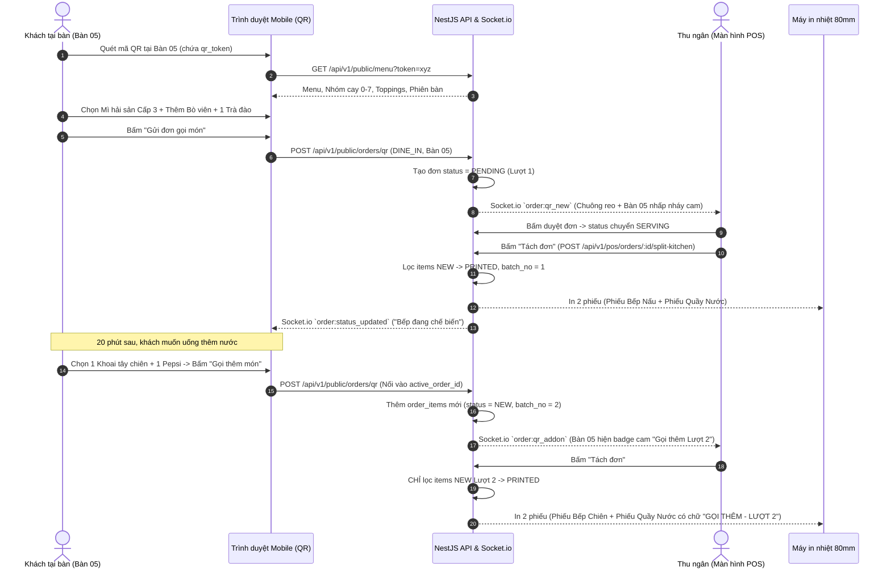
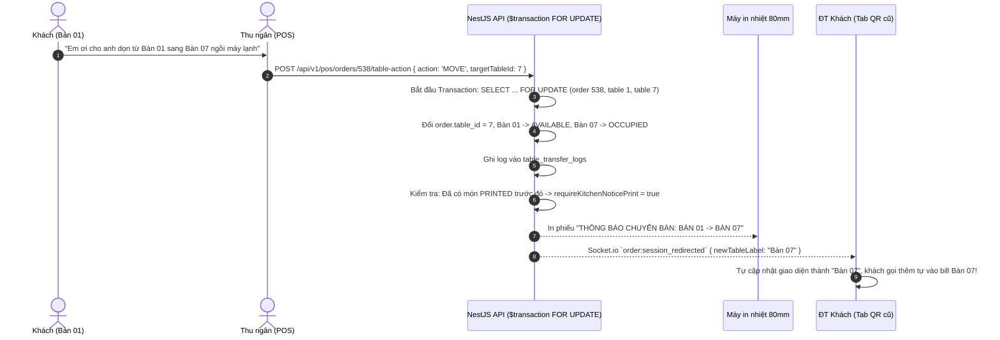
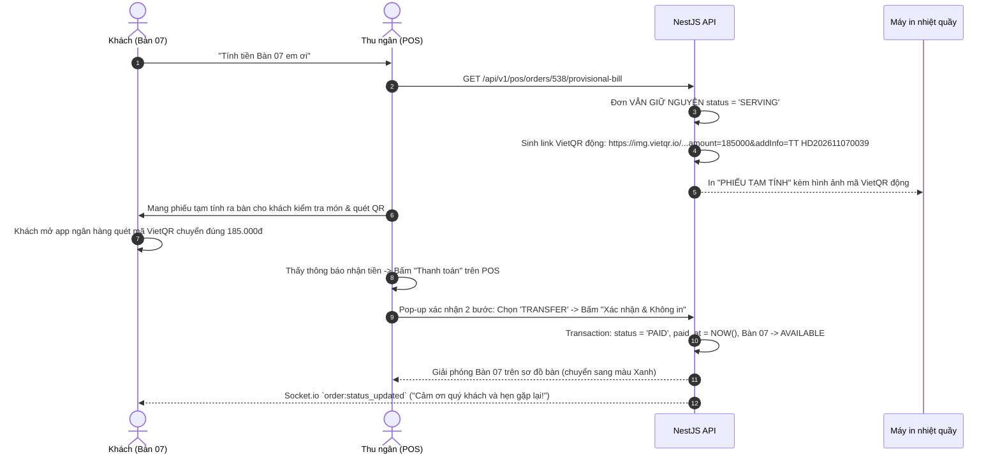

# BMAD Product Requirements Document (PRD) — Master Specification
# Hệ thống POS & Quản trị Vận hành Cửa hàng Mì Cay (fnb-spicy-noodle-system)

> **Tài liệu:** 01-PRD-Master.md  
> **Phiên bản:** 1.0.0 (BMAD Phase 1 Final)  
> **Vai trò thực hiện:** BMAD Business Analyst & Product Manager  
> **Trạng thái:** FINAL  
> **Ngày phê duyệt:** 2026-11-07  
> **Phạm vi:** Toàn bộ 10 Modules (Module 0 đến Module 9)  
> **Quy chuẩn tuân thủ:** 10 Hard Invariants tại `AGENTS.md` và `.agents/rules/*.md`

---

## 1. TỔNG QUAN SẢN PHẨM & BỐI CẢNH DOANH NGHIỆP

### 1.1. Bối cảnh & Điểm đau Vận hành (Pain Points)
Cửa hàng kinh doanh F&B ẩm thực đặc thù: **Mì cay nhiều cấp độ, đồ ăn vặt chiên nóng, và quầy pha chế nước uống**. 
- **Quy mô hoạt động:** 20–30 bàn ăn tại chỗ, khu vực tiếp đón khách mua mang về, lưu lượng 200–600 đơn hàng/ngày. Giờ cao điểm tập trung từ 18:00 đến 21:30.
- **Mô hình chế biến tách biệt 3 trạm (Stations):**
  1. `BEP_NAU`: Phụ trách mì cay (cấp độ 0–7, mì kim chi bò, hải sản, lẩu mini).
  2. `BEP_CHIEN`: Phụ trách đồ chiên nhanh (khoai tây chiên, cá viên, phô mai que, gà rán).
  3. `PHA_CHE`: Phụ trách quầy nước (trà sữa, trà đào cam sả, nước ngọt có ga).
- **Điểm nghẽn cũ:** Nhân viên ghi giấy note tay cho khách, chuyển vào quầy thu ngân. Thu ngân phải xé hoặc chép lại thành 3 mẩu giấy note con chạy đi phát cho 3 bếp. Khi khách gọi thêm món (add-on), đổi cấp độ cay, hoặc chuyển bàn, giấy note thất lạc gây nhầm món, sót món, nấu thừa hoặc sai tiền khi thanh toán.
- **Điểm đau đối soát:** Doanh thu chuyển khoản QR bị tính gộp chung vào tiền mặt trong két khiến đối soát kết ca cuối ngày luôn báo thiếu tiền giả tạo; tiền rút két đi chợ mua rau/đá bi không được trừ tự động vào dòng tiền lý thuyết.

### 1.2. Tầm nhìn & Mục tiêu Sản phẩm (Vision & Objectives)
Xây dựng một hệ thống phần mềm **POS & Quản trị Vận hành (Mini ERP) khép kín, siêu nhẹ, thời gian thực** theo kiến trúc **Modular Monolith trong Turborepo**, vận hành mượt mà với đội ngũ tinh gọn (1–2 developers):
1. **Triệt tiêu 100% việc chép giấy note thủ công:** Khách tự quét QR tại bàn hoặc nhân viên bấm order tại quầy; hệ thống tự động phân tách (Delta Split) các món mới gọi xuống đúng 3 trạm bếp kèm logo nhận diện trên giấy in nhiệt 80mm tự động cắt.
2. **Đối soát Dòng tiền chính xác tuyệt đối:** Công thức kết ca tự động tách bạch Doanh thu Tiền mặt (`CASH`) và Chuyển khoản QR (`TRANSFER`), tự động khấu trừ phiếu chi mua nguyên vật liệu từ tiền két (`CASH_DRAWER`).
3. **Quản trị Nhân sự & Lịch làm việc trực quan:** Bảng ma trận ca làm việc tuần dạng Excel với cơ chế chống mất dữ liệu (Unsaved Changes Guard) và nhận diện nhân viên bằng tên viết tắt gắn màu theo chuyên môn.
4. **Hiệu năng & Trải nghiệm đỉnh cao (60 FPS):** Độ trễ thao tác tại quầy POS dưới 50ms, in bill dưới 500ms, kéo giãn cột bảng và sidebar mượt mà không re-render giật lag, giữ nguyên cấu hình giao diện cá nhân khi đăng xuất.

---

## 2. CHÂN DUNG NGƯỜI DÙNG & HÀNH TRÌNH TRẢI NGHIỆM (PERSONAS & USER JOURNEYS)

### 2.1. Danh mục Nhân vật (Personas)
1. **Khách hàng tại bàn (`QR_GUEST`):** Sử dụng smartphone quét mã QR dán trên bàn ăn. Cần xem menu trực quan có hình ảnh, chọn cấp độ cay (0–7), chọn topping thêm có giá rõ ràng, gọi thêm món đợt 2–3 mà không bị gián đoạn, và quét mã VietQR động để thanh toán nhanh tại bàn.
2. **Khách mua mang về / Khách vãng lai (`WALK_IN_GUEST`):** Đứng tại quầy gọi món trực tiếp. Được cấp số thẻ mang về (`Mang về #01`, `#02`...) hoặc chọn bàn trống để vào ngồi.
3. **Nhân viên Thu ngân (`CASHIER`):** Trung tâm điều phối đơn. Thao tác trên máy tính quầy POS (màn hình cảm ứng hoặc chuột + phím). Nhận thông báo đơn QR thời gian thực, duyệt đơn, tạo đơn mang về, bấm "Tách đơn" 3 bếp, xử lý đổi/gộp bàn khi khách chuyển chỗ, bấm "In tạm tính" đưa bill VietQR cho khách, và xác nhận "Thanh toán" giải phóng bàn.
4. **Nhân viên Bếp / Pha chế (`STATION_CHEF`):** Đứng tại 3 trạm độc lập. Nhận lệnh qua máy in nhiệt 80mm tự động cắt phiếu có logo nhận diện riêng (`CHEF_HAT_NOODLE`, `FRENCH_FRIES`, `DRINK_CUP`), thông tin bàn to rõ, nhãn lượt gọi ("Lượt 1", "GỌI THÊM - LƯỢT 2") và phiếu báo đổi bàn.
5. **Chủ quán / Quản trị viên (`SUPER_ADMIN`):** Cấu hình thực đơn, kiểm soát ngân sách mặc định đầu ngày, giám sát lịch sử hoá đơn, huỷ đơn ngoại lệ (`void`), nhập kho nguyên liệu tự lưu Master Data, xếp lịch làm việc tuần, và phân quyền chi tiết cho nhân viên.

### 2.2. Hành trình Người dùng Mẫu (User Journeys)

#### Hành trình UJ-01: Khách quét QR gọi món tại bàn & Gọi thêm món (Add-on Order)


#### Hành trình UJ-02: Chuyển bàn (Bàn 01 sang Bàn 07) khi khách đang ăn


#### Hành trình UJ-03: In tạm tính VietQR động và Chốt thanh toán


---

## 3. ĐẶC TẢ CHI TIẾT 10 MODULES HỆ THỐNG (FUNCTIONAL REQUIREMENTS)

### 3.1. Module 0: Quản trị Thực đơn, Topping, Combo & Bàn QR (`Menu & Dining Tables`)

#### 3.1.1. Mục tiêu & Nghiệp vụ
Cung cấp hạt nhân dữ liệu cho toàn bộ chu trình đặt món, phân bổ món về trạm bếp và định danh bàn ăn bảo mật.

#### 3.1.2. Danh mục Tính năng Chi tiết
- **FR-0.1: Định danh Bàn ăn & Sinh mã QR Bảo mật:**
  - Quản lý từ 20 đến 30 bàn ăn vật lý (`Bàn 01` đến `Bàn 30`) và 1 vị trí trừu tượng `Mang về` (chỉ dùng hiển thị danh mục, khi tạo đơn mang về tuân theo Invariant 2).
  - Mỗi bàn có một chuỗi ngẫu nhiên bảo mật cao `qr_token` (UUID v4 hoặc token mã hoá 64 ký tự).
  - URL mã QR dán tại bàn: `https://tenquan.vn/qr/:qrToken`.
  - Cơ chế chống đặt đơn ảo từ xa: Đơn QR gửi lên khi bàn chưa có phiên ăn sẽ rơi vào trạng thái `PENDING` (Chờ duyệt). Thu ngân nhìn thấy khách ngồi thực tế mới bấm duyệt đơn chuyển sang `SERVING`.
- **FR-0.2: Quản lý Món ăn & Gán Trạm chế biến (`Station`):**
  - Mỗi món ăn (`products`) bắt buộc thuộc về 1 trong 4 giá trị trạm chế biến:
    - `BEP_NAU`: Mì kim chi, mì cay hải sản, mì bò, lẩu mini...
    - `BEP_CHIEN`: Khoai tây chiên, gà lắc, phô mai que, xúc xích rán...
    - `PHA_CHE`: Trà sữa, trà đào, nước ép, nước ngọt lon...
    - `COMBO`: Gói kết hợp nhiều món liên trạm.
  - Các thuộc tính: `name`, `price` (NUMERIC 12,2), `station`, `is_available` (Soft disable khi hết hàng), `image_url` (tải lên Cloudflare R2), `sort_order`.
- **FR-0.3: Cấu hình Tuỳ chọn Món (`Modifier Groups` & `Modifiers`):**
  - **Nhóm bắt buộc chọn 1 (Radio):** Điển hình là "Cấp độ cay" từ Cấp 0 đến Cấp 7 (`is_required = true`, `max_select = 1`, `extra_price = 0`).
  - **Nhóm chọn nhiều có tính thêm tiền (Checkbox):** Điển hình là "Thêm Topping" (`is_required = false`, `max_select = N`, `extra_price > 0` như Thêm bò viên +15.000đ, Thêm phô mai +10.000đ, Thêm tôm +20.000đ).
  - Topping khi đặt hàng được chụp lại cấu trúc (`modifiers_snapshot` JSONB) vào chi tiết đơn để bảo toàn giá trị lịch sử kể cả khi sau này giá topping trong menu thay đổi.
- **FR-0.4: Cấu hình Món Combo & Thuật toán Phân rã Trạm (Combo Explosion):**
  - Định nghĩa bảng quan hệ `combo_items`: Một món có `station = 'COMBO'` sẽ liên kết với nhiều `child_product_id` kèm `quantity`.
  - Ví dụ `Combo Đôi`: Chứa 2 Mì kim chi bò (`BEP_NAU`) + 1 Khoai tây chiên (`BEP_CHIEN`) + 2 Trà đào (`PHA_CHE`).
  - Trên hoá đơn của khách hiển thị 1 dòng `Combo Đôi`. Khi thực hiện Tách đơn bếp (API `split-kitchen`), hệ thống tự động phân rã thành các sub-items và gán về đúng 3 trạm tương ứng, **CẤM TUYỆT ĐỐI** gửi chữ `COMBO` xuống bếp.

---

### 3.2. Module 1: Màn hình POS Hợp nhất, Tách Bếp & Chuyển/Gộp Bàn (`pos-counter`)

#### 3.2.1. Mục tiêu & Bố cục Giao diện
Tích hợp toàn bộ thao tác tại quầy trên một màn hình duy nhất theo bố cục **Chia đôi màn hình (Split-View POS)**:
- **Nửa bên trái (50–60%):** Lật linh hoạt giữa **Tab 1: Sơ đồ Bàn / Đơn** và **Tab 2: Thực đơn Gọi món nhanh**.
- **Nửa bên phải (40–50%):** **Hoá đơn Điện tử Thời gian thực (Live Invoice)** kèm cụm nút thao tác nghiệp vụ tốc độ cao.

#### 3.2.2. 3 Nguồn Tạo Đơn Hợp nhất (Unified Ingestion)
| Nguồn | `order_type` | `order_source` | Status Khởi tạo | Ràng buộc Dữ liệu & Hành vi |
|:---|:---|:---|:---|:---|
| **A. Khách quét QR** | `DINE_IN` | `QR_CODE` | `PENDING` | `table_id` NOT NULL, `takeaway_number` NULL. Bàn chuyển màu Cam nhấp nháy + chuông kêu. Thu ngân bấm duyệt -> chuyển sang `SERVING`. |
| **B. Thu ngân bấm Bàn** | `DINE_IN` | `POS_COUNTER` | `SERVING` | Thu ngân click vào ô bàn trống trên sơ đồ -> chuyển sang tab Menu -> chọn món -> đơn sinh ra ngay ở trạng thái `SERVING`. |
| **C. Đơn Mang về** | `TAKEAWAY` | `POS_COUNTER` | `SERVING` | Thu ngân bấm nút lớn `[+ TẠO ĐƠN MANG VỀ]` -> hệ thống tự cấp `takeaway_number` tự tăng (`Mang về #01`, `#02`...) -> `table_id` BẮT BUỘC là `NULL`. |

#### 3.2.3. Quy tắc Đơn Mang về (TAKEAWAY — Hard Invariant 2)
1. Trường `table_id` **MUST** là `NULL`.
2. Trường `takeaway_number` **MUST NOT** là `NULL`.
3. Số thứ tự `takeaway_number` bắt đầu từ 1 và **tự động reset về 1 vào đầu mỗi ngày kinh doanh mới** (00:00:00).
4. Nhãn hiển thị trên màn hình POS và trên phiếu in nhiệt: `"Mang về #01"`, `"Mang về #02"`, ...
5. Khách mang về được phục vụ song song độc lập, không chiếm dụng bất kỳ bàn vật lý nào trên sơ đồ bàn.

#### 3.2.4. Thuật toán Tách Đơn 3 Trạm Bếp (Delta Split — Hard Invariant 3)
- **API Endpoint:** `POST /api/v1/pos/orders/:id/split-kitchen`
- **Các bước thực thi:**
  1. Kiểm tra transaction với khoá dòng `SELECT ... FOR UPDATE` trên bảng `orders`.
  2. Lọc các bản ghi trong `order_items` thoả mãn: `order_id = :id AND kitchen_status = 'NEW'`.
  3. Nếu không có món nào thoả mãn: Trả về HTTP 200 kèm message: `"Không có món mới cần tách"`, không sinh phiếu in.
  4. Nếu có món thuộc `station = 'COMBO'`: Phân rã thành các sub-items và map vào station thực tế.
  5. Tính toán số thứ tự lượt gọi: `current_batch = MAX(batch_no) + 1` (nếu đơn mới thì `batch_no = 1`, gọi thêm thì `batch_no = 2, 3...`).
  6. Gom nhóm món theo 3 trạm: `BEP_NAU`, `BEP_CHIEN`, `PHA_CHE`.
  7. Cập nhật `kitchen_status = 'PRINTED'`, ghi `batch_no = current_batch`.
  8. Trả về payload gồm tối đa 3 tickets tương ứng với các trạm có món phát sinh:
     - Trạm `BEP_NAU`: `stationTitle: "BẾP NẤU (MÌ CAY)"`, `logoType: "CHEF_HAT_NOODLE"`.
     - Trạm `BEP_CHIEN`: `stationTitle: "BẾP CHIÊN"`, `logoType: "FRENCH_FRIES"`.
     - Trạm `PHA_CHE`: `stationTitle: "QUẦY NƯỚC UỐNG"`, `logoType: "DRINK_CUP"`.
  9. Nếu `batch_no > 1`: In thêm dòng chữ nổi bật trên đầu phiếu: `"[GỌI THÊM - LƯỢT {batch_no}]"`.
  10. **QUY TẮC CẤM:** Tuyệt đối không bao giờ in lại các món đã ở trạng thái `PRINTED`.

#### 3.2.5. Tách bạch Tạm tính và Thanh toán (Hard Invariant 4)
- **Nút "In tạm tính (Kèm VietQR động)":**
  - Giữ nguyên `order.status = 'SERVING'`. **CẤM TUYỆT ĐỐI** chuyển sang `PAID`.
  - Sinh URL ảnh mã VietQR động chuẩn Napas247 nhúng sẵn tài khoản ngân hàng quán, số tiền `amount = total_amount`, và nội dung chuyển khoản `memo = "TT " + order_code` (Ví dụ: `"TT HD202611070039"`).
  - In ra phiếu kiểm món để nhân viên cầm ra bàn cho khách kiểm tra món ăn và quét mã chuyển khoản. Khách vẫn có thể yêu cầu bớt món (nếu bếp chưa làm) hoặc đổi món lúc này.
- **Nút "Thanh toán (Đóng đơn)":**
  - Mở Dialog xác nhận 2 bước chống bấm nhầm (`Xác nhận / Huỷ bỏ`).
  - Cho phép chọn Phương thức thanh toán: `CASH` (Tiền mặt), `TRANSFER` (Chuyển khoản QR), hoặc `SPLIT` (Hỗn hợp: nhập cả `cash_amount` và `transfer_amount`).
  - Khi bấm Xác nhận:
    1. Chuyển trạng thái `orders.status = 'PAID'`, ghi nhận `paid_at = NOW()`.
    2. Giải phóng bàn: `dining_tables.status = 'AVAILABLE'`, xoá con trỏ `active_order_id = NULL`.
    3. Cung cấp 2 lựa chọn: "Xác nhận & In hoá đơn" hoặc "Xác nhận & Không in" (tiết kiệm giấy vì khách đã cầm phiếu tạm tính).
    4. Bắn sự kiện Socket.io `order:status_updated` xuống điện thoại khách hiện thông báo cảm ơn.

#### 3.2.6. Thao tác Bàn: Chuyển bàn (MOVE), Gộp bàn (MERGE), Hoán đổi bàn (SWAP)
- **API Endpoint:** `POST /api/v1/pos/orders/:id/table-action`
- **Ràng buộc Concurrency (Hard Invariant 5):** Bắt buộc bọc trong `prisma.$transaction()` với thứ tự khoá dòng `SELECT ... FOR UPDATE` trên bảng `orders` trước, sau đó tới `dining_tables` để tránh Deadlock.
- **Hành vi theo từng loại hành động:**
  - **1. MOVE (Chuyển sang bàn trống):**
    - Điều kiện tiên quyết: Bàn đích bắt buộc phải ở trạng thái `AVAILABLE`. Nếu bàn đích đã `OCCUPIED` -> Bắn lỗi HTTP 409 Conflict.
    - Cập nhật `order.table_id = targetTableId`. Đổi bàn nguồn thành `AVAILABLE`, bàn đích thành `OCCUPIED`.
    - Ghi log vào `table_transfer_logs`.
    - Nếu đơn đã có món `PRINTED`: Cờ `requireKitchenNoticePrint = true`, tự động in ra phiếu `"THÔNG BÁO CHUYỂN BÀN"` xuống các trạm bếp bị ảnh hưởng.
  - **2. MERGE (Gộp vào bàn đang có khách ngồi ăn):**
    - Điều kiện tiên quyết: Cả bàn nguồn và bàn đích đều phải có đơn đang mở (`SERVING`). **CẤM GỘP ĐƠN TAKEAWAY** (HTTP 409 Conflict).
    - Chuyển toàn bộ `order_items` từ đơn nguồn sang đơn đích (cập nhật `order_id = targetOrderId`), giữ nguyên trạng thái `kitchen_status` của từng món để không in lại món đã in.
    - Đơn nguồn chuyển sang `status = 'MERGED'`, ghi nhận `merged_into_order_id = targetOrderId`.
    - Giải phóng bàn nguồn về `AVAILABLE`. Đơn đích được cộng dồn tổng tiền.
  - **3. SWAP (Hoán đổi 2 bàn):**
    - Điều kiện: Cả 2 bàn đều có đơn đang mở.
    - Hoán đổi giá trị `table_id` và các con trỏ `active_order_id` trên `dining_tables`. Ghi log vào cả 2 đơn.
- **Đồng bộ Điện thoại Khách (Session Redirect qua WebSocket):**
  - Sau khi MOVE hoặc MERGE, Server phát sự kiện Socket.io `order:session_redirected` tới room `order_session_{orderId}` của điện thoại khách:
    ```json
    {
      "previousOrderId": 538,
      "newActiveOrderId": 540,
      "previousTableLabel": "Bàn 01",
      "newTableId": 7,
      "newTableLabel": "Bàn 07",
      "message": "Đơn hàng của bạn đã được chuyển sang Bàn 07."
    }
    ```
  - Trình duyệt trên điện thoại của khách tự động cập nhật session sang Bàn 07 mà **không cần quét lại mã QR**, loại bỏ 100% rủi ro gọi thêm món rơi lại vào bàn cũ.

---

### 3.3. Module 2: Quản lý & Tra cứu Hoá đơn (`invoices`)

#### 3.3.1. Cấu trúc Base Table Hoá đơn (7 Cột Chuẩn)
Mọi bảng dữ liệu kế thừa từ BaseTable xây dựng trên TanStack Table v8:
1. `STT`: Số thứ tự dòng tăng dần.
2. `Mã hoá đơn`: Chuỗi định dạng chuẩn `HD-YYYYMMDD-NNNN` (Click để xem nhanh).
3. `Bàn / Hình thức`: Hiển thị badge `"Bàn 05"` hoặc `"Mang về #02"`.
4. `Thời điểm tạo`: Hiển thị ngày giờ dạng `DD/MM/YYYY HH:mm:ss`.
5. `Tổng tiền & PTTT`: Số tiền kèm Badge màu (Xanh lá: `CASH`, Xanh dương: `TRANSFER`, Tím: `SPLIT`).
6. `Ghi chú & Trạng thái`: Badge trạng thái đơn (`SERVING`, `PAID`, `MERGED`, `VOIDED`) kèm ghi chú nếu có.
7. `Thao tác`: Action buttons:
   - Icon `Eye` (Con mắt): Mở Modal xem chi tiết món ăn, các lượt gọi (batch), vết chuyển bàn, in lại hoá đơn.
   - Nút `Huỷ đơn (Void)`: Chỉ hiển thị khi user có quyền `invoices:void`. Bắt buộc nhập `void_reason`. Đơn chuyển sang `VOIDED` và bị khấu trừ khỏi doanh thu ngày.

#### 3.3.2. Bộ lọc Kép Tách bạch (Date Range & Keyword Search)
- **Bên trái thanh công cụ:** Bộ chọn ngày / khoảng thời gian (`DateRangePicker`). Mặc định chọn sẵn `Hôm nay` để câu lệnh SQL đánh index `created_at` tải trang dưới 20ms. Cho phép chọn hôm qua, tuần này, hoặc khoảng ngày tuỳ chỉnh.
- **Bên phải thanh công cụ:** Dropdown tiêu chí tìm kiếm (`Mã hoá đơn`, `Số bàn`, `Ghi chú`) kết hợp với ô nhập từ khoá `keyword`. Hai bộ lọc hoạt động đồng thời (điều kiện AND), giải quyết dứt điểm điểm nghẽn tra cứu.

---

### 3.4. Module 3: Quản lý Nhập hàng Nguyên vật liệu (`inventory`)

#### 3.4.1. Cấu trúc Base Table Nhập hàng (8 Cột Chuẩn)
1. `STT`
2. `Ngày nhập`: Định dạng `DD/MM/YYYY`.
3. `Tên món hàng`: Tên nguyên liệu lấy từ Master Data.
4. `Đơn vị tính`: `Kg`, `Thùng`, `Gói`, `Két`, `Bao`...
5. `Đơn giá`: Đơn giá trên 1 đơn vị tính (`NUMERIC(12, 2)`).
6. `Số lượng`: Số lượng thực nhập (`NUMERIC(10, 2)`).
7. `Thành tiền`: Tự động tính = `Đơn vị tính * Số lượng` (`NUMERIC(12, 2)`).
8. `Nguồn tiền & Ghi chú`: Badge phân biệt `CASH_DRAWER` (Tiền két) hoặc `EXTERNAL` (Quỹ ngoài/Chủ CK).
9. `Thao tác`: Icon `Trash` (Thùng rác) ở cột cuối cùng để xoá dòng nhập nhầm (Soft delete `is_deleted = true`, có pop-up confirm; nhân viên chỉ được xoá phiếu trong ca làm việc hiện tại, ngày cũ chỉ Admin mới có quyền xoá).

#### 3.4.2. Tách bạch Thanh Lọc Lịch sử vs Drawer Thêm mới
- **Thanh tìm kiếm trên Base Table:** CHỈ dùng để lọc lịch sử theo Ngày/Tháng/Năm và Tên nguyên liệu. Phía dưới chân bảng hiển thị dòng tổng kết: **"Tổng tiền nhập hàng trong kỳ: xxx.xxx đ"**.
- **Drawer "Thêm mới" (Mở từ bên phải màn hình):**
  - Cho phép nhập danh sách nhiều dòng hàng cùng lúc trước khi bấm Lưu.
  - Ô nhập Tên món hàng là một **Smart Combobox**: Gõ từ khoá gọi API `GET /api/v1/mdm/lookup?category=INGREDIENT` để gợi ý nhanh.
  - Khi chọn nguyên liệu có sẵn: Tự động điền đơn vị tính và gợi ý đơn giá nhập của lần gần nhất từ `master_data.metadata`.
  - Nếu gõ tên nguyên liệu mới hoàn toàn chưa có trong hệ thống: Khi bấm submit, hệ thống tự động gọi `MdmService.findOrCreate()` để chuẩn hoá và lưu ngay nguyên liệu mới vào Master Data (Module 7).
  - Chọn Nguồn tiền thanh toán (Radio):
    - `CASH_DRAWER` (Tiền két thu ngân — mặc định): Tự động khấu trừ vào công thức Kết ca ở Module 4.
    - `EXTERNAL` (Quỹ ngoài / Chủ chuyển khoản): Chỉ ghi nhận chi phí kho, KHÔNG trừ vào tiền mặt tại két.

---

### 3.5. Module 4: Ngân sách, Dòng tiền & Đối soát Kết ca (`cashflow`)

#### 3.5.1. Công thức Kết ca Dòng tiền Chuẩn xác (Hard Invariant 6)
Để loại bỏ 100% tình trạng báo thiếu tiền ảo do lẫn lộn doanh thu chuyển khoản QR và tiền chi mua rau/đá bi, thuật toán kết ca áp dụng công thức toán học bất biến:

$$\text{expected\_cash\_in\_drawer} = \text{opening\_budget} + \sum \text{total\_amount}_{\text{CASH, PAID}} - \sum \text{total\_cost}_{\text{CASH\_DRAWER, NOT\_DELETED}}$$

$$\text{discrepancy\_amount} = \text{actual\_counted\_cash} - \text{expected\_cash\_in\_drawer}$$

$$\text{status} = \begin{cases} \text{MATCHED} & \text{khi } \text{discrepancy\_amount} = 0 \\ \text{SURPLUS} & \text{khi } \text{discrepancy\_amount} > 0 \\ \text{SHORTAGE} & \text{khi } \text{discrepancy\_amount} < 0 \end{cases}$$

- **QUY TẮC CẤM:**
  - **FORBIDDEN** cộng doanh thu `TRANSFER` (chuyển khoản QR) vào `expected_cash_in_drawer` (tiền ngân hàng không nằm trong két vật lý).
  - **FORBIDDEN** trừ phiếu nhập hàng `EXTERNAL` khỏi tiền két.

#### 3.5.2. Component Đếm tiền theo Mệnh giá & Giao diện Kết ca
- **Cấu hình Ngân sách mặc định (`opening_budget`):** Tiền lẻ để trong két đầu ngày phục vụ thối tiền (Ví dụ: 1.000.000đ). Chỉ tài khoản có quyền `cashflow:config` (Super Admin) mới được sửa qua `PUT /api/v1/cashflow/default-budget`.
- **Component Đếm tiền theo Mệnh giá:**
  - Bảng lưới gồm các mệnh giá tiền Việt Nam: 500.000đ, 200.000đ, 100.000đ, 50.000đ, 20.000đ, 10.000đ, 5.000đ, 2.000đ, 1.000đ kèm ô nhập số tờ.
  - Tự động nhân thành tiền từng loại và cộng dồn ra con số `actual_counted_cash`, giúp thu ngân kiểm tiền lúc nửa đêm không bị nhầm lẫn bấm máy tính.
- **Bàn giao sau khi bấm nút "Kết ca":**
  - Hiển thị bảng tóm tắt rõ ràng:
    1. Tiền mặt giữ lại trong két cho ca/ngày mai: Bằng đúng mức `opening_budget` (1.000.000đ).
    2. Số tiền mặt thực tế rút ra khỏi két nộp cho Chủ quán: `actual_counted_cash - opening_budget`.
- **Base Table Lịch sử Kết ca:** Các cột gồm: Ngày/Ca, Ngân sách đầu ca, Thu tiền mặt, Thu QR, Chi tiền két, Tiền lý thuyết, Tiền thực đếm, Chênh lệch, Tình trạng (Badge Xanh: `Chuẩn`, Vàng: `Dư`, Đỏ: `Thiếu`), Người đóng ca.

---

### 3.6. Module 5: Quản lý Hồ sơ Nhân sự (`employees`)

#### 3.6.1. Cấu trúc Bảng & Tìm kiếm
- **Base Table 7 Cột:** `STT`, `Tên nhân viên` (kèm Tên viết tắt), `Năm sinh`, `Chức vụ`, `Chuyên môn`, `Ghi chú`, `Thao tác` (`Eye` xem chi tiết, `Pencil` chỉnh sửa, `Trash` xoá mềm có confirm).
- **Bộ lọc Đa năng:** Dropdown bên trái chọn lọc theo `Chức vụ` hoặc `Chuyên môn` (lấy từ MDM) kết hợp ô nhập từ khoá tìm theo Tên hoặc Số điện thoại.

#### 3.6.2. Thuật toán Tự sinh Tên Viết tắt Nhân viên (`short_name`)
- Áp dụng hàm chuẩn xác: Lấy chữ cái đầu của Tên lót + Tên chính.
  - Ví dụ: `"Nguyễn Văn Anh"` -> `words = ["Nguyễn", "Văn", "Anh"]` -> `short_name = "V.Anh"`.
- **Xử lý xung đột trùng tên (Collision Handling):** Nếu danh sách nhân viên đang làm việc đã tồn tại `"V.Anh"` (ví dụ có cả Nguyễn Văn Anh và Trần Văn Anh):
  - Tự động nối thêm chữ cái đầu của Họ và mã số nhân viên: `"N.V.Anh (#12)"` và `"T.V.Anh (#15)"`.
  - Hiển thị tên viết tắt này trong ô ma trận Lịch làm việc Module 6.

#### 3.6.3. Liên kết 1-1 giữa `employees` và `users`
- Bảng `employees`: Lưu trữ hồ sơ nhân sự thực tế (họ tên, ngày sinh, CCCD, nơi cấp, địa chỉ, SĐT, thông tin ngân hàng, ngày vào làm, chức vụ, chuyên môn, avatar, file hợp đồng đính kèm).
- Bảng `users`: Lưu trữ thông tin đăng nhập và phân quyền hệ thống. Cột `users.employee_id` là Foreign Key **UNIQUE** trỏ tới `employees.id`.
- Mọi nhân viên có tài khoản thì đều lấy thông tin cá nhân và ngân hàng từ `employees`. Khi nhân viên cập nhật thông tin tại trang Hồ sơ tài khoản (Module 9), dữ liệu được đồng bộ trực tiếp về `employees`.

---

### 3.7. Module 6: Lịch làm việc Ma trận Dạng Excel (`schedules`)

#### 3.7.1. Cấu trúc Bảng Ma trận Tuần (Excel-like Matrix Grid)
- **7 Cột:** Thứ Hai, Thứ Ba, Thứ Tư, Thứ Năm, Thứ Sáu, Thứ Bảy, Chủ Nhật.
- **N Dòng:** Các khung giờ / ca làm việc cấu hình linh hoạt (Ca Sáng 08:00–15:00, Ca Tối 15:00–22:00, Ca Gãy...).
- **Cơ chế Multi-select Tags theo Chuyên môn:**
  - Một ô giao giữa Ngày và Ca cho phép chọn **nhiều nhân viên cùng làm việc**.
  - Mỗi nhân viên hiển thị dạng Tag/Chip với tên viết tắt (`V.Anh`) kèm màu sắc phân biệt chuyên môn:
    - `BEP_NAU`: Tag màu Đỏ.
    - `BEP_CHIEN`: Tag màu Cam.
    - `PHA_CHE`: Tag màu Xanh dương.
    - Chuyên môn khác: Tag màu Xám/Tím.
  - Quản lý nhìn lướt qua trong 2 giây biết ngay ca đó đã đủ người cho 3 trạm bếp hay chưa.

#### 3.7.2. Điều hướng Tuần & Sao chép Lịch
- Thanh chuyển tuần ở đầu bảng: `[< Tuần trước] | [Tuần 45: 02/11/2026 - 08/11/2026] | [Tuần sau >]`. Lưu trữ trong DB theo `week_start_date` (ngày Thứ 2 đầu tuần) để bảo toàn 100% lịch sử các tuần cũ phục vụ chấm công tính lương.
- Nút `[Sao chép từ tuần trước]`: Sao chép nhanh toàn bộ ma trận phân ca của tuần liền trước sang tuần hiện tại, quản lý chỉ việc tinh chỉnh các ca xin nghỉ rồi bấm Lưu.

#### 3.7.3. Cơ chế Bảo vệ Thay đổi Chưa lưu (Unsaved Changes Guard)
- Khi người dùng thay đổi dữ liệu bất kỳ ô nào trên bảng mà chưa bấm nút `[Lưu]`:
  1. Kích hoạt sự kiện `window.addEventListener('beforeunload', handler)` để chặn hành vi reload trang hoặc tắt tab trình duyệt.
  2. Kích hoạt React Router Navigation Blocker để chặn hành vi click menu Sidebar hoặc chuyển trang trong app.
  3. Bật Modal cảnh báo: `"Bạn có thay đổi lịch làm việc chưa lưu. Bạn có chắc chắn muốn rời khỏi trang?"`.
  4. Sau khi bấm `[Lưu]` thành công (API `PUT /api/v1/schedules/bulk-save`), gỡ bỏ toàn bộ blocker.
- **Xử lý nhân viên bị Soft-delete giữa tuần:** Nhân viên đã bị xoá mềm trong tuần vẫn hiển thị tên trên ô lịch với màu xám mờ (grayed out) kèm nhãn `(Đã nghỉ)`, tuyệt đối không gây lỗi crash bảng.

---

### 3.8. Module 7: Quản trị Master Data (`master-data`)

#### 3.8.1. Danh mục & Phân loại
Giao diện Tabs quản lý các nhóm danh mục dùng chung toàn hệ thống:
1. `POSITION`: Chức vụ nhân sự (Quản lý, Thu ngân, Bếp chính, Phụ bếp, Phục vụ...).
2. `SPECIALTY`: Chuyên môn trạm làm việc (`BEP_NAU`, `BEP_CHIEN`, `PHA_CHE`, `PHUC_VU`).
3. `INGREDIENT`: Tên nguyên liệu nhập kho (Ba chỉ bò Mỹ, Mì Hàn Quốc, Tương ớt Gochujang, Bạch tuộc, Phô mai mozzarella, Đá bi, Hộp xốp...).
4. `UNIT`: Đơn vị tính (Kg, Thùng, Gói, Két, Chai, Cây...).

#### 3.8.2. Thuật toán Chuẩn hoá Chuỗi Tự động (Hard Invariant 7)
Mọi thao tác lưu danh mục tự động từ Module 3 (Nhập hàng) và Module 5 (Nhân sự) đều phải đi qua phương thức duy nhất `MdmService.findOrCreate(category, rawInput)`:
1. `rawInput.trim()`: Cắt bỏ khoảng trắng thừa ở 2 đầu.
2. `capitalizeWords()`: Chuẩn hoá chữ hoa đầu từ (Ví dụ: `"mì cay hải sản "` -> `"Mì Cay Hải Sản"`).
3. `removeVietnameseDiacritics().toLowerCase()`: Chuyển đổi chuỗi tiếng Việt có dấu sang không dấu và viết thường làm giá trị `normalized_name` (Ví dụ: `"mi cay hai san"`).
4. Kiểm tra Database với khoá duy nhất: `category + normalized_name`. Nếu đã tồn tại bản ghi `is_active = true` -> Trả về bản ghi cũ. Nếu chưa có -> Tạo bản ghi mới.
5. Loại bỏ triệt để rác dữ liệu do lỗi gõ phím của nhân viên giữa các ca làm việc.

---

### 3.9. Module 8: Phân quyền Hệ thống Đa cấp (`rbac`)

#### 3.9.1. Cấu trúc Quản trị Phân quyền
- **Base Table Danh sách Tài khoản:** Hiển thị `username`, `Họ tên nhân viên`, `Trạng thái`, và nút `[+ Thêm mới tài khoản]` (Chỉ Super Admin mới thấy và thực hiện được; chọn nhân viên liên kết từ Module 5).
- **Drawer Cấu hình Quyền (Bấm Bánh răng Settings trên từng dòng):**
  - Danh sách toàn bộ các màn hình hiển thị dưới dạng Checkbox kiểm soát quyền Xem/Truy cập (`view`). Khi được tích chọn, màn hình mới xuất hiện trên Sidebar và thanh điều hướng.
  - Dưới mỗi màn hình có Dropdown cấu hình CRUD chi tiết: `Create`, `Update`, `Delete`.
  - Hỗ trợ các quyền nghiệp vụ con (**Sub-permissions**):
    - Dưới Module 4: Checkbox `[ ] Cấu hình ngân sách mặc định (cashflow:config)`.
    - Dưới Module 2: Checkbox `[ ] Huỷ hoá đơn đã thanh toán (invoices:void)`.
- **Đặc quyền Super Admin:**
  - Tài khoản có `is_super_admin = true` mặc định có toàn bộ quyền (Full Permissions).
  - Trên giao diện Drawer, tất cả Checkbox và Dropdown của Super Admin đều hiển thị ở trạng thái **DISABLED / READONLY** (Không ai có thể tự hạ quyền của Super Admin).

#### 3.9.2. Quy tắc Mã lỗi HTTP (Hard Invariant 8)
- `401 Unauthorized`: Token JWT bị thiếu, không hợp lệ, hoặc đã hết hạn. **CẤM TUYỆT ĐỐI** trả về mã 403 cho trường hợp này.
- `403 Forbidden`: Người dùng đã đăng nhập hợp lệ nhưng không có quyền truy cập vào màn hình hoặc API endpoint được yêu cầu. **CẤM TUYỆT ĐỐI** trả về mã 401 cho trường hợp này.
- **Tách bạch API Lookup:** Endpoint `GET /api/v1/mdm/lookup` bắt buộc mở cho mọi tài khoản `authenticated` (đã đăng nhập) để lấy dữ liệu autocomplete cho combobox nhập hàng và dropdown nhân viên, không đòi hỏi quyền quản trị `mdm:read` / `mdm:write`.

---

### 3.10. Module 9: Thanh Navbar, Hồ sơ Cá nhân & Tuỳ biến Giao diện (`layout`)

#### 3.10.1. Cấu trúc Thanh Navbar (Thứ tự Góc Phải)
Từ trái sang phải:
1. `[Thanh Search nhỏ / Command Palette]` (Nhấn chuột hoặc phím tắt `Ctrl + K` / `Cmd + K`): Mở Pop-up tìm kiếm nhanh màn hình theo danh mục Sidebar. **BẮT BUỘC** lọc theo quyền RBAC của người dùng đang đăng nhập (User chỉ thấy các màn hình mình có quyền truy cập).
2. `[Nút chuyển Theme Sáng/Tối]` (Light / Dark Mode toggle): Khoảng cách tách biệt rõ ràng.
3. `[Avatar + Tên người dùng]` (Nối liền thành một khối bấm được): Click mở Dropdown gồm 2 tuỳ chọn: `Hồ sơ tài khoản` và `Đăng xuất`.

#### 3.10.2. Trang Hồ sơ Tài khoản Cá nhân
- Đọc dữ liệu JOIN từ cả 2 bảng `employees` và `users`.
- Các trường `Chức vụ` và `Chuyên môn` hiển thị dạng Badge **READONLY**.
- Cho phép nhân viên tự chỉnh sửa: Số điện thoại, Địa chỉ nơi ở, Thông tin ngân hàng (Tên NH, Số TK, Chủ TK), và Tải lên/cắt ảnh đại diện (`Avatar Crop & Resize`). Khi lưu, tự động đồng bộ về bảng `employees`.

#### 3.10.3. Kéo giãn Cột Bảng, Sidebar & Hành vi Đăng xuất (Hard Invariant 9)
- **Kéo giãn Cột (BaseTable Column Resize):** Sử dụng TanStack Table v8 với `columnResizeMode: 'onChange'`, điều khiển bằng CSS Variables và `requestAnimationFrame` đạt 60fps mượt mà. Debounce 500ms khi thả chuột để lưu cấu hình độ rộng cột vào `localStorage` và đồng bộ lên `users.ui_preferences`.
- **Kéo giãn Sidebar:** Nắm kéo chuột thanh phân cách để thay đổi độ rộng Sidebar từ 200px đến 360px hoặc thu gọn về Icon-only mode.
- **HÀNH VI KHI ĐĂNG XUẤT (LOGOUT INVARIANT):**
  1. Gọi `queryClient.clear()` xoá sạch toàn bộ bộ nhớ đệm API dữ liệu nghiệp vụ (không để rò rỉ dữ liệu tài chính/hoá đơn cho ca sau).
  2. Xoá Access Token và Refresh Token khỏi bộ nhớ.
  3. Xoá thông tin định danh Auth State.
  4. **CẤM TUYỆT ĐỐI** xoá `ui_preferences` (cấu hình theme Sáng/Tối, độ rộng cột bảng, độ rộng sidebar) khỏi `localStorage` và Database. Khi người dùng đăng nhập lại trên máy đó, giao diện phục hồi chính xác bố cục đã tuỳ biến.

---

## 4. QUY CHUẨN IN NHIỆT KHỔ 80MM (THERMAL PRINT SPECIFICATION)

### 4.1. Cấu hình In ngầm & Ngắt trang Tự cắt giấy
- Máy tính thu ngân khởi chạy trình duyệt Chrome/Edge với tham số: `--kiosk-printing` (tắt pop-up preview của trình duyệt, bắn thẳng lệnh xuống máy in nhiệt mặc định trong 0,5 giây).
- Định dạng CSS `@media print`:
  ```css
  @media print {
    @page {
      size: 80mm auto;
      margin: 0;
    }
    body * {
      visibility: hidden;
    }
    #thermal-print-container, #thermal-print-container * {
      visibility: visible;
    }
    #thermal-print-container {
      position: absolute;
      left: 0;
      top: 0;
      width: 72mm; /* Trừ lề an toàn 4mm mỗi bên cho khổ 80mm */
    }
    .ticket-page {
      width: 100%;
      padding: 2mm 0;
      break-after: page;
      page-break-after: always; /* Kích hoạt lệnh cắt giấy vật lý giữa các phiếu */
    }
  }
  ```

### 4.2. Đặc tả 4 Mẫu Phiếu In Nhiệt Chuẩn

```
================================================================================
MẪU 1: PHIẾU TÁCH BẾP (In ra 3 phiếu rời nhau theo từng trạm chế biến)
================================================================================
              [ LOGO: CHEF_HAT_NOODLE / FRENCH_FRIES / DRINK_CUP ]
                           BẾP NẤU (MÌ CAY)
                           
BÀN: BÀN 07                              Mã Đơn: HD-20261107-0039
Thời gian: 07/11/2026 19:25:30            Lượt: GỌI THÊM - LƯỢT 2
[GHI CHÚ ĐỔI BÀN: Chuyển từ BÀN 01 sang BÀN 07]
----------------------------------------------------------------
TÊN MÓN                             SL   GHI CHÚ / CẤP ĐỘ CAY
----------------------------------------------------------------
Mì Kim Chi Bò                       02   Cấp độ 3 - Ít hành
  + Thêm Bò viên                    02
Mì Hải Sản                          01   Cấp độ 1 - Không ớt bột
----------------------------------------------------------------
Ghi chú đơn: Cho ớt bột để riêng chén nhỏ
================================================================

================================================================================
MẪU 2: PHIẾU THÔNG BÁO CHUYỂN BÀN (In ngay khi MOVE/MERGE đơn đã có món PRINTED)
================================================================================
                     ⚠️ THÔNG BÁO ĐỔI BÀN ⚠️
                     
ĐƠN HÀNG: HD-20261107-0039
CHUYỂN TỪ:  >>> BÀN 01 <<<
SANG BÀN:   >>> BÀN 07 <<<
Thời gian: 07/11/2026 19:20:15
Trạm ảnh hưởng: BẾP NẤU, QUẦY PHA CHẾ
----------------------------------------------------------------
LƯU Ý: Các món đang chế biến của BÀN 01 vui lòng bưng qua BÀN 07!
================================================================

================================================================================
MẪU 3: PHIẾU TẠM TÍNH (In kèm mã VietQR động cho khách quét thanh toán)
================================================================================
                           QUÁN MÌ CAY SƠN BẢO
                       ĐC: 123 Đường Số 8, Linh Xuân, TP. Thủ Đức
                           PHIẾU TẠM TÍNH
                           
Số Bàn: BÀN 07                           Mã HĐ: HD-20261107-0039
Giờ vào: 19:00:22                        Giờ in: 19:45:10
Thu ngân: V.Anh
----------------------------------------------------------------
Tên món                     SL       Đơn giá         Thành tiền
----------------------------------------------------------------
Mì Kim Chi Bò (Cấp 3)       2        55.000             110.000
  + Thêm Bò viên            2        15.000              30.000
Khoai tây chiên             1        30.000              30.000
Trà đào cam sả              2        25.000              50.000
----------------------------------------------------------------
TỔNG CỘNG TIỀN MÓN:                                     220.000 đ
GIẢM GIÁ (0%):                                               0 đ
----------------------------------------------------------------
TỔNG THANH TOÁN:                                        220.000 đ
----------------------------------------------------------------
               QUÉT MÃ VIETQR ĐỂ CHUYỂN KHOẢN TỰ ĐỘNG
                  [ ẢNH MÃ VIETQR ĐỘNG CHUẨN NAPAS247 ]
               (Đã nhúng sẵn số tiền 220.000đ & TT HD0039)
                  
                 Phiếu này dùng để kiểm tra món ăn.
                 Quý khách vui lòng không dùng làm hoá đơn tài chính.
================================================================

================================================================================
MẪU 4: HOÁ ĐƠN THANH TOÁN CHÍNH THỨC (In sau khi bấm Thanh toán -> Xác nhận)
================================================================================
                           QUÁN MÌ CAY SƠN BẢO
                       HOÁ ĐƠN THANH TOÁN (PAID)
                       
Số HĐ: HD-20261107-0039                  Bàn: BÀN 07
Ngày: 07/11/2026 19:48:00                Thu ngân: V.Anh
Phương thức thanh toán:                  CHUYỂN KHOẢN (QR)
----------------------------------------------------------------
TỔNG TIỀN THANH TOÁN:                                   220.000 đ
----------------------------------------------------------------
               CẢM ƠN QUÝ KHÁCH VÀ HẸN GẶP LẠI!
================================================================
```

---

## 5. RÀNG BUỘC KỸ THUẬT & YÊU CẦU PHI CHỨC NĂNG (NFR)

### 5.1. Kiểu Tiền tệ Bắt buộc (Hard Invariant 10)
- Mọi trường dữ liệu lưu trữ giá trị tiền tệ (`price`, `total_amount`, `total_cost`, `opening_budget`, `cash_amount`, `transfer_amount`, `unit_price`, `extra_price`, `expected_cash_in_drawer`, `actual_counted_cash`, `discrepancy_amount`) **MUST** sử dụng kiểu `NUMERIC(12, 2)` trong PostgreSQL và kiểu `Decimal` trong Prisma ORM.
- **FORBIDDEN:** Tuyệt đối không dùng `FLOAT`, `DOUBLE`, `REAL`, hoặc `INT` cho tiền tệ để tránh sai số dấu phẩy động.

### 5.2. Hiệu năng & Khả năng Chịu tải (Performance SLAs)
- **Độ trễ API nội bộ tại quầy POS:** $\le 50\text{ ms}$ cho các thao tác chọn món, cập nhật giỏ hàng và duyệt đơn.
- **Tốc độ xử lý lệnh In nhiệt:** $\le 500\text{ ms}$ từ lúc click "Tách đơn" tới khi dao cắt máy in hoạt động.
- **Tốc độ tải Menu QR trên Mobile khách (4G):** $\le 400\text{ ms}$ qua mạng lưới Cloudflare CDN tại Việt Nam.
- **Tốc độ phản hồi giao diện kéo giãn cột bảng:** 60 FPS mượt mà bằng CSS Variables và `requestAnimationFrame`.

### 5.3. Độ sẵn sàng & An toàn Dữ liệu (Reliability & Disaster Recovery)
- Cơ chế Interactive Transaction trong PostgreSQL đảm bảo tính nguyên tử (ACID) cho các thao tác nhạy cảm: Chuyển/Gộp bàn, Kết ca đối soát dòng tiền và Tách đơn.
- Tự động sao lưu dữ liệu (`pg_dump`) mỗi ngày lúc 03:00 sáng, nén và tải lên Cloudflare R2 với chi phí 0đ.
- Phục hồi toàn bộ hệ thống sau sự cố vật lý trong thời gian dưới 5 phút.

---

> **Tài liệu PRD Master Specification này là căn cứ gốc có hiệu lực cao nhất.**  
> Các bước thiết kế kiến trúc, biên dịch rules, phân mảnh stories và lập trình mã nguồn ở các Phase tiếp theo bắt buộc đối chiếu tuân thủ 100% tài liệu này.
