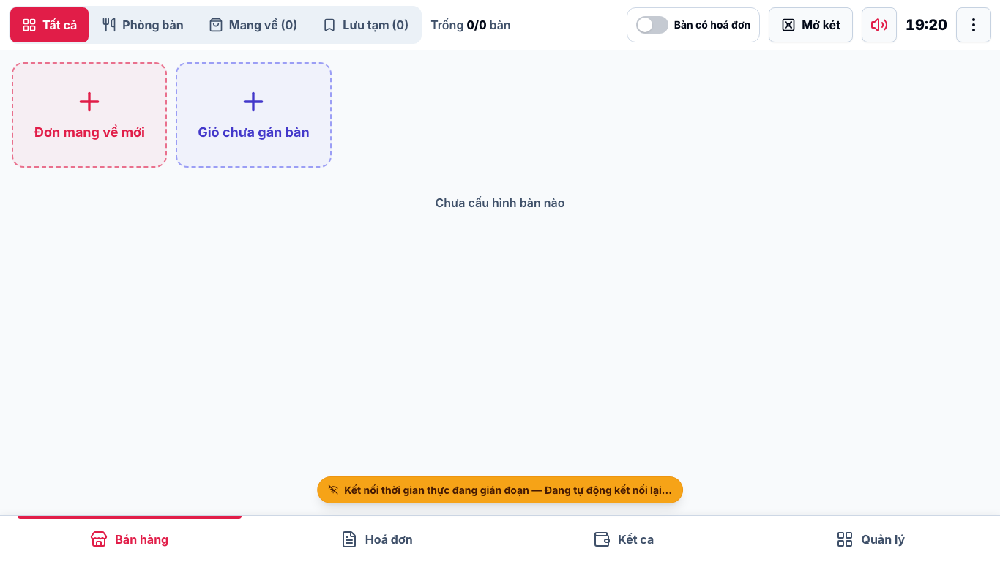
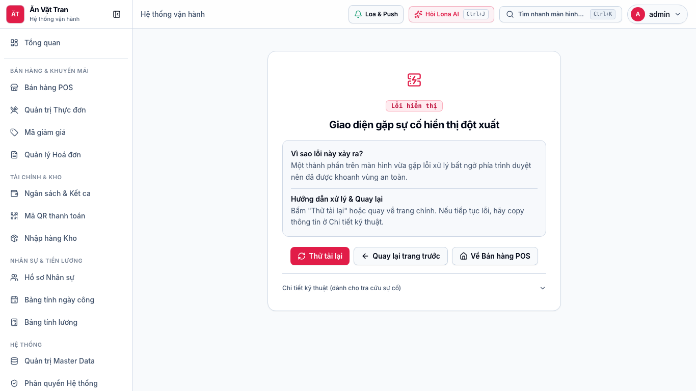

# Rà soát độ ổn định khi để màn hình lâu — 28/11/2026

> Post-fix status: [REMEDIATION.md](REMEDIATION.md). The observations and evidence below are the historical pre-fix audit; standalone tests now check the corrected behavior.

Hệ thống là POS và quản trị quán, dùng HTTP để tải dữ liệu và Socket.io để cập nhật tức thời. Phạm vi rà soát là các luồng dùng chung có thể gây lỗi sau 15–30 phút: phiên đăng nhập, mạng, bộ nhớ đệm, realtime, vòng đời trang, xử lý lỗi và triển khai. Quy mô giả định theo AGENTS.md: 20–30 bàn, 200–600 đơn/ngày.

## Kết luận

**Đã xác nhận một nguyên nhân tạo ra biểu hiện ở ảnh POS:** polling trong `AppShell` biến lỗi API thành dữ liệu thành công `null`, ghi đè sơ đồ bàn dùng chung với màn POS. Màn POS sau đó biến `null` thành mảng rỗng và hiển thị **“Trống 0/0 bàn / Chưa cấu hình bàn nào”**. Kiểm thử trình duyệt tái hiện được từ sơ đồ 24 bàn đang hiển thị, chỉ bằng một đợt lỗi HTTP 503. Đoạn mã gây lỗi cũng có trong JavaScript production được lấy mẫu.

**Ảnh Cài đặt chưa xác định được nguyên nhân gốc của lần xảy ra thực tế.** Cùng thông báo “Giao diện gặp sự cố hiển thị đột xuất” xuất hiện khi API trả JSON sai schema, dù không có lỗi render React. Vì vậy ảnh không đủ để kết luận React crash, lỗi Android hay lỗi hết hạn token. Cần thông tin lỗi gốc ở đúng thời điểm, không chỉ mã chung `RUNTIME_CRASH`.

Ngoài ra, đã kiểm chứng hai đường chờ không giới hạn trong HTTP client và một khoảng trống đồng bộ khi socket kết nối lại. Mốc token mặc định 15 phút phù hợp thời gian người dùng mô tả nhưng **chưa xác minh thời hạn token thực tế của production và chưa chứng minh token là tác nhân của hai lần chụp ảnh**.

### Môi trường và độ tin cậy

- Thiết bị được người dùng cung cấp: Android 11, treo khoảng 15–30 phút; chưa biết phiên bản Chrome, RAM và cơ chế tiết kiệm pin.
- Audit bắt đầu tại `faa62013089c59e2575fcf35dd55d372a8231178`, checkout có thay đổi AI/Lona từ công việc khác. Trong lúc audit, HEAD được công việc khác cập nhật tới `8b5bb6cbe43bf455a027a1e8d5672e6b8a6f7062`. Các file gây lỗi được nêu dưới đây không đổi giữa hai HEAD.
- Lỗi typecheck/test AI ở lần chạy đầu thuộc trạng thái làm dở đó; **lần kiểm tra cuối đã xanh**, không còn xem chúng là phát hiện chưa xử lý.
- Kiểm thử giao diện dùng Chromium của Playwright, kích thước 1366×768, bật cảm ứng, API giả lập từ fixture sẵn có. Fixture tắt socket thật; kiểm tra socket riêng dùng Vitest và mock socket.
- Production chỉ được kiểm tra bằng GET công khai qua Ego Lite; không có phiên đăng nhập, không gọi API ghi, không deploy, seed hoặc sửa DB.
- DBHub dùng đúng source `fnb_pos`; chưa xác minh source này chính là DB production. Không dùng số liệu DBHub để kết luận dữ liệu production có hay không có bàn.

## Các lỗi cần sửa trước

### 1. Lỗi polling ghi đè sơ đồ bàn bằng `null` — P1, đã tái hiện và thấy trong production

**Chức năng:** `AppShell` polling sơ đồ bàn cho cảnh báo QR, dùng cùng query key `['pos', 'tables']` với cả POS thường và POS cảm ứng.

**Vấn đề:** [`app-shell.tsx`](../../../apps/web-app/src/components/layout/app-shell.tsx#L142) trả `null` khi fetch lỗi hoặc validation thất bại. TanStack Query nhận đây là một lần tải thành công nên thay dữ liệu cũ bằng `null`, không gọi xử lý lỗi query. [`pos-touch-page.tsx`](../../../apps/web-app/src/features/pos-counter/touch/pos-touch-page.tsx#L150) dùng `gridData?.tables ?? []`; nhánh báo lỗi chỉ chạy khi `isError`, nên không chặn được kết quả “thành công null”.

**Bằng chứng:** kiểm tra `background API 503` tải đủ 24 bàn, cho polling nhận 503, quan sát `0/0` và thông báo chưa cấu hình, không có `pageerror`. Sau khi API được khôi phục, polling kế tiếp hiển thị bàn trở lại. Asset production `/assets/index-Be86oXL_.js` cũng chứa `return t.success?t.data:null` và `catch{return null}` với chu kỳ 12/25 giây.

**Sửa nhỏ nhất:** cho `AppShell` dùng chung `fetchPosTableGrid` hiện có; bỏ kiểu kết quả `| null` và không nuốt lỗi. Giữ dữ liệu thành công gần nhất khi refetch lỗi để cơ chế toast lỗi nền hiện có hoạt động. Không cần đổi API, Prisma hay nghiệp vụ bàn.

**Nếu để nguyên:** một đợt mạng/API lỗi ngắn có thể khiến nhân viên tưởng mất cấu hình bàn. Nếu request tiếp theo bị kẹt ở lỗi số 2 hoặc 3, sơ đồ rỗng có thể tồn tại lâu.



### 2. Gia hạn đăng nhập không có thời hạn chờ — P1, đã kiểm chứng; có trong production

**Chức năng:** [`attemptTokenRefresh`](../../../apps/web-app/src/lib/api-client.ts#L72) dùng một promise chung để nhiều request chỉ gia hạn token một lần.

**Vấn đề:** request `/auth/refresh` không có timeout/abort. Nếu fetch hoặc việc đọc JSON không kết thúc, promise chung không được giải phóng; những request sau gặp 401 hoặc cần khôi phục phiên sẽ tiếp tục chờ nó. Giới hạn 15 giây của request nghiệp vụ không bao phủ thời gian chờ gia hạn này.

**Bằng chứng:** hai lời gọi đồng thời tạo đúng một fetch; sau 30 phút đồng hồ mô phỏng cả hai vẫn chưa kết thúc, fetch không nhận abort signal. Giải phóng fetch giả lập thì cả hai mới hoàn thành. Asset production `/assets/dialog-DW3qEOzs.js` chứa cùng request refresh không có signal.

**Sửa nhỏ nhất:** đặt thời hạn 15 giây cho toàn bộ fetch và đọc body của refresh; giải phóng promise chung ở mọi đường kết thúc. Timeout, mất mạng và 5xx giữ phiên hiện tại và cho phép lần phục hồi tiếp theo thử lại; phiên thực sự bị thu hồi/hết hạn phải theo contract xác thực hiện có. Không tự gửi lại thanh toán, in hay tạo đơn do timeout.

**Nếu để nguyên:** mạng “vẫn nối nhưng không trả kết quả” có thể chặn phục hồi phiên tới khi browser tự ngắt request hoặc người dùng refresh trang. Đây là đường lỗi đã chứng minh, chưa phải bằng chứng nó xảy ra ở thời điểm ảnh.

### 3. Timeout API hiện chỉ chặn đến lúc nhận headers — P1, đã kiểm chứng local

**Chức năng:** [`api-client.ts`](../../../apps/web-app/src/lib/api-client.ts#L291) tạo timer 15 giây cho request thông thường.

**Vấn đề:** timer bị xóa ngay sau `fetch()` trả `Response`; việc đọc `response.text()`, JSON lỗi và các bước 401 diễn ra sau đó. Khi headers đã tới nhưng body đứng lại, query/mutation vẫn có thể treo. Ngoài ra, khi caller cung cấp `signal`, đoạn mã hiện không tạo timeout nội bộ.

**Bằng chứng:** fetch trả headers thành công, body giả lập không kết thúc; sau 30 phút mô phỏng request vẫn pending và không còn timer nào. Kiểm tra này không giả định API server thực tế đã từng gửi body dở.

**Sửa nhỏ nhất:** giữ deadline tới khi đọc body xong, áp dụng cho cả response thành công và lỗi; kết hợp hủy từ caller với deadline thay vì bỏ deadline khi có signal. Giữ khả năng phân biệt hủy chủ động và timeout. Không retry mutation không có đảm bảo chống trùng.

**Nếu để nguyên:** polling đang pending không hoàn thành để chạy vòng kế tiếp, hoặc nút thao tác tiếp tục ở trạng thái chờ dù thông báo timeout nói chỉ chờ 15 giây.

## Các điểm nên sửa

### 4. Chưa có dữ liệu bị trình bày giống dữ liệu rỗng — P2, đã tái hiện

**Chức năng:** POS cảm ứng hiển thị số bàn và thông báo trống.

**Vấn đề:** trong lúc request đầu tiên chưa phản hồi, fallback `?? []` đã hiển thị “0/0 bàn / Chưa cấu hình bàn nào”. Người dùng không phân biệt được đang tải, tải lỗi và cấu hình thực sự rỗng.

**Bằng chứng:** giữ request `/pos/tables` chưa trả lời thấy thông báo rỗng; thả request thì đủ bàn xuất hiện. Response hợp lệ `{ tables: [], takeaways: [] }` cũng cho cùng thông báo.

**Sửa nhỏ nhất:** khi chưa có lần tải thành công, hiển thị trạng thái đang tải hoặc lỗi/thử lại; chỉ hiển thị chưa cấu hình khi response hợp lệ thực sự có danh sách rỗng. Khi đã có dữ liệu cũ, tiếp tục hiển thị nó kèm trạng thái kết nối.

**Nếu để nguyên:** lỗi số 1, 2 và 3 bị che bởi thông báo nghiệp vụ không đúng nguyên nhân.

### 5. Lỗi validation bị phân loại thành “lỗi hiển thị”, thông tin tra cứu thiếu nguyên nhân — P2, đã tái hiện

**Chức năng:** [`error-resolver.ts`](../../../apps/web-app/src/components/error-display/error-resolver.ts#L125) và [`SystemErrorView`](../../../apps/web-app/src/components/error-display/system-error-view.tsx#L386) chuẩn hóa lỗi cho nhân viên.

**Vấn đề:** `Error` không thuộc một vài nhóm đặc biệt, bao gồm `ZodError`, bị coi là runtime crash. Chi tiết kỹ thuật/copy trace chỉ có mã chung, request ID nếu có, path và giờ; không có tên lỗi gốc, build hay browser. Lỗi parse response HTTP 200 cũng không giữ request ID của response thành công để truy ngược.

**Bằng chứng:** cho `/settings` trả 200 với JSON sai schema, giao diện hiện đúng tiêu đề trong ảnh 1 trong khi danh sách `pageerror` rỗng. Đây là ví dụ phản chứng cho suy luận “cứ thấy thông báo đó là React bị crash”; không xác nhận response sai schema chính là tác nhân của ảnh người dùng.

**Sửa nhỏ nhất:** phân biệt lỗi cấu trúc dữ liệu với lỗi render; lưu/copy thông tin chẩn đoán đã làm sạch gồm tên/loại lỗi, thời điểm đầy đủ, route không chứa token, build, browser và request ID khi có. Nếu cần ghi nhận lỗi tại boundary/global handler, dùng dữ liệu có giới hạn và không ghi JWT, cookie, request/response body, thông tin khách hàng hoặc stack máy chủ lên giao diện.

**Nếu để nguyên:** các lỗi khác nhau trông giống nhau; việc chỉ refresh sẽ làm mất dấu vết cần để tìm nguyên nhân thực tế.



### 6. Kết nối lại socket chưa đồng bộ các query đã bỏ lỡ sự kiện — P2, đã kiểm chứng local

**Chức năng:** [`SocketProvider`](../../../apps/web-app/src/providers/socket-provider.tsx#L112) invalidates dữ liệu khi nhận sự kiện nghiệp vụ; query mặc định tắt refetch khi focus.

**Vấn đề:** khi kết nối lại, provider chỉ invalidates `store-settings` và `store-messages`. POS có xử lý riêng cho bàn/đơn, nhưng menu, nhân viên, lịch, bảng lương và các dữ liệu phụ thuộc sự kiện có thể giữ bản cũ nếu sự kiện bị bỏ lỡ khi mất kết nối. `staleTime` hết hạn tự nó không phát sinh request mới.

**Bằng chứng:** mount query menu đang hoạt động với dữ liệu cũ, mô phỏng ngắt/kết nối lại và trở lại foreground sau 30 phút: query function không được gọi, dữ liệu menu vẫn cũ. Kiểm tra chỉ xác nhận cơ chế chung này; các trang có polling riêng như dashboard có thể tự phục hồi bằng đường khác.

**Sửa nhỏ nhất:** sau khi xác thực và socket phục hồi, invalidates các nhóm dữ liệu nghiệp vụ phụ thuộc realtime; chỉ refetch query đang hoạt động, không xóa cache hoặc reset state biểu mẫu. Giữ cơ chế chống ghi đè bản nháp Cài đặt/lịch và tránh phát lại các thông báo đơn cũ.

**Nếu để nguyên:** ứng dụng có thể hiện kết nối bình thường nhưng dữ liệu vẫn cũ tới khi có sự kiện mới, chuyển trang hoặc tải lại.

### 7. Gia hạn chủ động thất bại không tự lên lịch lại — P2, đã kiểm chứng riêng provider

**Chức năng:** [`SocketProvider`](../../../apps/web-app/src/providers/socket-provider.tsx#L91) lên lịch gia hạn trước hết hạn 90 giây.

**Vấn đề:** callback chỉ gọi refresh một lần. Nếu refresh trả `null` do lỗi tạm thời và access token không đổi thì effect không chạy lại để lên lịch tiếp. Phục hồi lúc này phụ thuộc request 401 tiếp theo, connect error hoặc sự kiện visible/online.

**Bằng chứng:** token 15 phút, refresh chủ động thất bại ở khoảng phút 13,5; sau tổng hai giờ mô phỏng không có lần gia hạn chủ động thứ hai trong provider biệt lập. HTTP polling của AppShell có thể kích hoạt gia hạn phản ứng, nên không kết luận riêng lỗi này khiến toàn POS treo.

**Sửa nhỏ nhất:** retry có giãn cách khi lỗi tạm thời và trang đang hoạt động; chỉ một quá trình gia hạn dùng chung, dừng khi logout/đổi phiên, không tạo vòng lặp 401 hay retry dồn khi thiết bị thức dậy. Làm sau khi đã xử lý deadline ở lỗi số 2.

**Nếu để nguyên:** một lỗi mạng ngắn làm mất lớp gia hạn chủ động trong phần còn lại của token đó.

## Kiểm thử và bằng chứng

Các test audit là **characterization test**: pass nghĩa là quan sát được hành vi mô tả, bao gồm hành vi lỗi. Chúng chưa phải regression test bảo đảm bản sửa đã đúng. Khi sửa ứng dụng phải đảo assertion lỗi sang hành vi mong muốn và đưa regression thích hợp vào suite thường.

| Kiểm tra | Kết quả |
|---|---|
| `pnpm -r --no-bail typecheck` | Pass cả 3 package |
| `pnpm -r --no-bail test` | 1.166 pass: shared 103, API 531, web 532 |
| `pnpm -r lint` | Pass cả 3 package |
| Build web sau build shared | Pass |
| Playwright hiện có: POS Touch, Touch Shell, layout Cài đặt | 30/30 pass |
| Chẩn đoán HTTP/socket bằng Vitest | 5/5 pass |
| Chẩn đoán toàn giao diện bằng Playwright | 7/7 pass |
| Polling 503 làm mất bàn rồi phục hồi khi API có lại | Tái hiện |
| Refetch foreground dùng query của POS gặp lỗi mạng | Giữ được sơ đồ cũ; khác polling của AppShell |
| API Cài đặt sai schema | Cùng thông báo `RUNTIME_CRASH`, không có `pageerror` |
| Bản nháp Cài đặt sau 30 phút mô phỏng và foreground | Giữ nội dung, không tự PUT lưu |
| POS sau 15/30/60/120 phút mô phỏng | Còn bàn, không có lỗi JS |

Phiên hai giờ mô phỏng: sau thu gom rác, số listener **257 → 257**, số DOM document **1 → 1**, node **984 → 1.017**. Không thấy tăng listener trong kịch bản này. Không đo heap/RSS Android và không đủ để loại trừ rò rỉ bộ nhớ, lỗi tài nguyên âm thanh hoặc tác động chế độ tiết kiệm pin ở thiết bị thật. `fastForward` bỏ qua một phần lần lặp timer; đây không phải hai giờ tải liên tục theo thời gian thực.

Kiểm tra tĩnh cũng thấy toast giới hạn 3 bản tin, audio decode cache giới hạn 64, bộ theo dõi QR dọn key không còn hoạt động, socket server dọn session connections khi disconnect, và các listener chính có cleanup. Không tìm được bằng chứng cụ thể để quy hai ảnh cho rò rỉ bộ nhớ.

### Production và DB

- GET `/api/v1/health` lúc **19:21:01 ngày 28/11/2026 (+07)**: HTTP 200, `status: ok`, `database: connected`, uptime khoảng 4.227,8 giây. Đây là một mẫu trạng thái, không loại trừ gián đoạn trước đó.
- Asset entry production là `index-Be86oXL_.js`; build local cuối tạo `index-aJiSYtzq.js`. Hash khác nhau nên không khẳng định toàn bộ production giống HEAD. Đã đối chiếu trực tiếp đoạn polling lỗi và refresh không timeout trong asset production; lưu hash SHA-256 và snippet tại [`production-static.json`](evidence/production-static.json).
- `/assets/*` trả cache immutable 1 năm; `/sw.js` trả no-cache. SW hiện không có handler `fetch`, không phải cơ chế cache offline cho dữ liệu bàn. Caddy trả file tĩnh riêng cho `/assets/*`, không đưa JS thiếu về HTML SPA.
- Docker image frontend chỉ mang asset của build hiện tại; tab mở qua deploy vẫn có nguy cơ cần chunk cũ đã bị thay. Có lazy loading/prefetch và thông báo lỗi chunk, nhưng chưa có bằng chứng đây là nguyên nhân hai ảnh; không deploy thật để thử phá phiên production.
- DBHub `fnb_pos` lúc **19:12:41 (+07)**: 30 bàn `AVAILABLE`; 1 connection thuộc DB, 1 active (bao gồm query audit), 0 connection chờ lock. Chỉ là mẫu ở source được cấu hình, chưa xác minh cùng DB production.
- Backend gia hạn token kiểm tra trạng thái user và session ID, giữ session ID khi gia hạn; socket authenticate kiểm tra session, và có dọn session khi disconnect. Không thấy cơ chế cố ý xóa bàn hoặc kết thúc phiên chỉ vì không thao tác 15 phút. Thời hạn mặc định access token là 15 phút, refresh là 7 ngày; chưa đọc cấu hình bí mật production.

### Chạy lại

Chạy từ root repo, dùng dependencies đã cài; không cần tài khoản production hay DB cho các test giả lập:

```bash
pnpm --filter @fnb/shared build
pnpm --filter @fnb/web-app exec vitest run --config ../../docs/qa/idle-stability-2026-11-28/vitest.config.mts
pnpm --filter @fnb/web-app exec playwright test --config ../../docs/qa/idle-stability-2026-11-28/playwright.config.mts
pnpm --filter @fnb/web-app exec playwright test pos-touch.spec.ts pos-touch-shell.spec.ts store-settings-layout-regression.spec.ts --project chromium-desktop
pnpm -r --no-bail typecheck
pnpm -r --no-bail test
pnpm -r lint
```

Cấu hình audit khởi chạy Vite riêng ở `127.0.0.1:5173`, từ chối dùng lại server đang chiếm cổng. Chromium cần đã được cài cho Playwright. Rerun suite Playwright thường có thể dọn `apps/web-app/test-results`; ảnh/log đã chọn trong thư mục `evidence/` là bản sao cố định của lần audit này.

## Thứ tự sửa và tiêu chí nghiệm thu

1. **Sơ đồ bàn:** dùng một hàm fetch chuẩn, không ghi `null` khi mạng lỗi. Với API chậm, 503, mất mạng và schema sai: giữ bàn cũ nếu có; lần đầu tải phải hiện loading/lỗi đúng. Response rỗng hợp lệ mới hiện chưa cấu hình. Áp dụng cho POS thường, cảm ứng và cảnh báo QR toàn app.
2. **HTTP/gia hạn:** hoàn thành hoặc thất bại có giới hạn ở toàn bộ body/refresh; sau timeout, lần thử mới có thể thành công mà không reload. Giữ phân biệt 401/403, thu hồi phiên đúng và UI preferences. Không thêm retry mù cho thao tác ghi/in/thu tiền.
3. **Đồng bộ sau phục hồi:** cập nhật query đang hoạt động khi reconnect, giữ giỏ/bản nháp/biểu mẫu. Bổ sung kiểm tra bỏ lỡ sự kiện đổi menu, bàn, đơn, lịch và quyền; logout/đổi tài khoản không dùng dữ liệu phiên cũ.
4. **Chẩn đoán:** phân loại validation riêng; có mã lỗi và metadata đủ đối chiếu lần xảy ra, không lộ thông tin nhạy cảm. Sau sửa chạy typecheck, test, lint, nhóm E2E và build.
5. **Thiết bị thật trước khi chốt vận hành:** ghi phiên bản Chrome và build; kiểm tra màn hình vẫn mở, tắt/bật màn hình, chuyển app, mất Wi-Fi rồi có lại ở mốc 15/30 phút và một ca thử hai giờ thực tế. Ghi thời gian HTTP/refresh/socket, lỗi JS và trạng thái giỏ, tránh tạo giao dịch thật chỉ để kiểm tra. So sánh trước/sau bản sửa với cùng thiết bị.

**Chưa kiểm tra:** máy POS Android 11 thực tế, phiên Chrome cụ thể, hai giờ theo thời gian thực, phiên đăng nhập production, log VPS/container lịch sử, Cloudflare/Wi-Fi tại thời điểm lỗi, deploy qua phiên đang mở và tải nhiều máy đồng thời. Không có dữ liệu để xác nhận chính xác tác nhân của ảnh 1 hoặc gộp hai ảnh thành cùng một lỗi.

**Thay đổi trong đợt này:** chỉ bổ sung báo cáo, test chẩn đoán chạy riêng và bằng chứng. Không sửa mã hành vi ứng dụng/API/schema, không thêm dependency, không commit/deploy hoặc thay dữ liệu production. Ưu tiên sửa số 1 và số 2 trước.
