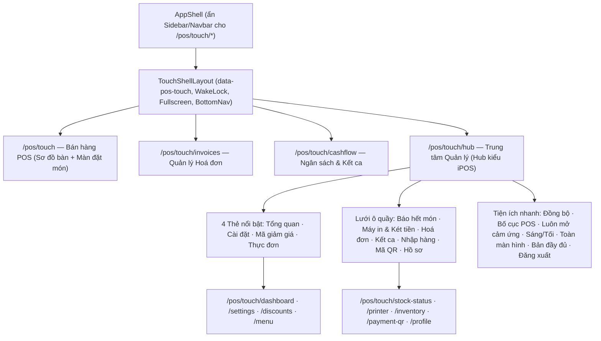

# Kế hoạch Triển khai Chi tiết: POS Touch Shell & Trung tâm Quản lý Cảm ứng (Kiểu iPOS)

> **Mã tài liệu:** `STORY-21` (`docs/stories/story-21-pos-touch-shell-and-hub.md`)
> **Trạng thái:** Đã triển khai (Completed — Giai đoạn 1)
> **Phạm vi:** 100% Frontend (`apps/web-app/`). **Không** thay đổi Backend, Prisma Schema hay `@fnb/shared`.
> **Tuân thủ bắt buộc:** `AGENTS.md` (đặc biệt Hard Invariants 1, 8, 9), `.agents/rules/00-architecture-and-monorepo.md`, `03-rbac-security-and-hr-schedule.md`, `04-frontend-ux-table-and-print.md`, `05-testing-strategy.md`, `07-deployment-and-git.md`.

---

## 1. Bối cảnh & Mục tiêu

Hiện tại màn hình POS cảm ứng (`/pos/touch`) đã hoạt động ổn định theo chế độ toàn màn hình (kiosk) với cơ chế `data-pos-touch="true"` và biến thể Tailwind `touch-ui:`. Tuy nhiên, vì `/pos/touch` đang đứng độc lập và ẩn toàn bộ Sidebar/Navbar của `AppShell`, mỗi khi thu ngân hoặc chủ quán cần tra cứu hoá đơn, kết ca, nhập hàng chi tiền két, báo hết món hay kiểm tra máy in, họ buộc phải bấm `⋮` → **"Thoát về giao diện đầy đủ"** rồi mới thao tác và quay lại.

**Mục tiêu Giai đoạn 1:**
1. Nâng cấp `/pos/touch` thành một **Touch Shell** hoàn chỉnh theo phong cách iPOS: có **Thanh điều hướng đáy 4 nút** (`Bán hàng · Hoá đơn · Kết ca · Quản lý`) và **Trang Trung tâm Quản lý (Hub)** dạng thẻ nổi bật + lưới ô lớn.
2. Cho phép mở trọn bộ **10 module/tiện ích cốt lõi tại quầy** ngay bên trong chế độ cảm ứng (giữ nguyên toàn màn hình, wake lock, `data-pos-touch="true"`, cảnh báo đơn QR realtime).
3. Giữ nguyên 100% trải nghiệm & test của bản Desktop (`/pos`, `/invoices`, `/cashflow`…) và các nghiệp vụ hiện có, tuân thủ tuyệt đối **Hard Invariant 1 (Cô lập Module)**.

---

## 2. Quyết định Thiết kế đã Thống nhất

| Hạng mục | Quyết định chốt |
|---|---|
| **Mô hình điều hướng** | Thanh điều hướng đáy 4 nút cố định (**Bán hàng · Hoá đơn · Kết ca · Quản lý**) + Trang **Trung tâm Quản lý (Hub)** lưới ô lớn giống iPOS. Thanh đáy **tự động ẩn** khi đang ở màn chọn món/tính tiền (`TouchOrderScreen`) để tối đa diện tích và tránh chạm nhầm. |
| **Phạm vi Giai đoạn 1 (10 mục)** | **4 thẻ nổi bật trên Hub:** Tổng quan (`/dashboard`), Cài đặt cửa hàng (`/settings`), Mã giảm giá (`/discounts`), Thực đơn đầy đủ (`/menu`).<br>**Lưới ô vận hành quầy:** Báo hết món nhanh, Máy in & Két tiền, Hoá đơn (`/invoices`), Kết ca (`/cashflow`), Nhập hàng Kho (`/inventory`), Mã QR thanh toán (`/payment-qr`), Hồ sơ & Đổi mật khẩu (`/profile`).<br>**Để Giai đoạn 2:** Nhân sự (`/employees`), Bảng công (`/schedules`), Bảng lương (`/payroll`), Master Data (`/master-data`), Phân quyền (`/rbac`). |
| **Chiến lược UI (Hybrid)** | Tái sử dụng 100% các trang sẵn có bên trong Touch Shell + nâng cấp `touch-ui:` CSS cho `BaseTable`/toolbar (dòng thoáng, nút ≥ 44–48px, cuộn mượt). Tách riêng **2 màn cảm ứng chuyên biệt nhẹ**: (1) **Báo hết món 1 chạm** và (2) **Máy in & Két tiền**. |
| **Kiến trúc Routing** | Nhánh route riêng `/pos/touch/*` (giữ nguyên `/pos/touch` cho Bán hàng; các trang con là `/pos/touch/hub`, `/pos/touch/invoices`, `/pos/touch/cashflow`, `/pos/touch/stock-status`, `/pos/touch/printer`, ...). Hỗ trợ F5 reload, nút Back Android, và nút "Thoát về giao diện đầy đủ" trỏ đúng sang trang desktop tương ứng. |
| **Phân quyền & An toàn Mở két** | Màn **Máy in & Két tiền** mở cho mọi tài khoản có quyền `pos.view` (dùng cấu hình thiết bị trong `localStorage`, không cần quyền `settings.view`). Nút **Mở két tiền** chỉ đặt bên trong màn này và **bắt buộc xác nhận 2 bước** để tránh chạm nhầm. |

---

## 3. Kiến trúc Kỹ thuật & Routing

### 3.1. Sơ đồ Điều hướng & Touch Shell



### 3.2. Bảng Mapping Route, Quyền RBAC & Desktop Fallback

| Touch Route | Màn hình | Component | Quyền RBAC (`RbacRouteGuard`) | Trang đích khi bấm "Bản đầy đủ" |
|---|---|---|---|---|
| `/pos/touch` | Bán hàng POS | `PosTouchPage` (hiện có) | `pos.view` | `/pos` |
| `/pos/touch/hub` | Trung tâm Quản lý | `TouchHubPage` (mới) | `pos.view` | `/pos` |
| `/pos/touch/stock-status` | Báo hết món nhanh | `TouchStockStatusPage` (mới) | `menu.view` *(chạm bật/tắt cần `menu.update`)* | `/menu` |
| `/pos/touch/printer` | Máy in & Két tiền | `TouchPrinterPage` (mới) | `pos.view` | `/settings` |
| `/pos/touch/invoices` | Quản lý Hoá đơn | `InvoicesPage` (tái sử dụng) | `invoices.view` | `/invoices` |
| `/pos/touch/cashflow` | Ngân sách & Kết ca | `CashflowPage` (tái sử dụng) | `cashflow.view` | `/cashflow` |
| `/pos/touch/inventory` | Nhập hàng Kho | `InventoryPage` (tái sử dụng) | `inventory.view` | `/inventory` |
| `/pos/touch/dashboard` | Tổng quan / Báo cáo | `DashboardPage` (tái sử dụng) | `dashboard.view` | `/dashboard` |
| `/pos/touch/menu` | Thực đơn đầy đủ | `MenuManagementPage` (tái sử dụng) | `menu.view` | `/menu` |
| `/pos/touch/discounts` | Mã giảm giá | `DiscountsPage` (tái sử dụng) | `discounts.view` | `/discounts` |
| `/pos/touch/payment-qr` | Mã QR thanh toán | `PaymentQrPage` (tái sử dụng) | `paymentQr.view` | `/payment-qr` |
| `/pos/touch/settings` | Cài đặt cửa hàng | `StoreSettingsPage` (tái sử dụng) | `settings.view` | `/settings` |
| `/pos/touch/profile` | Hồ sơ & Đổi mật khẩu | `ProfilePage` (tái sử dụng) | Authenticated (mọi user) | `/profile` |

> [!IMPORTANT]
> **Rủi ro nghiệp vụ đã phát hiện & cách xử lý bắt buộc trong [app-shell.tsx](../../apps/web-app/src/components/layout/app-shell.tsx):**
> Hiện dòng 57 đang viết `const isPosRoute = location.pathname.startsWith('/pos')` để tắt Global QR Voice Alert & Overdue QR Banner (vì tưởng `usePosWorkspace` đang chạy). Khi có các route con `/pos/touch/hub`, `/pos/touch/invoices`…, **PHẢI tách thành 2 biến riêng**:
> - `isPosTouchShellRoute`: khớp `/pos/touch` hoặc `/pos/touch/*` (khi `canReceivePosAlerts === true`) → dùng để ẩn Sidebar/Navbar/CommandPalette và bỏ padding `main`.
> - `isPosLiveBoardRoute`: **CHỈ** khớp chính xác `/pos` hoặc `/pos/touch` → dùng để điều khiển Global QR Voice Alert và Red Overdue Banner.
> - Khi đang ở `/pos/touch/*` (khác `/pos/touch`) mà có đơn QR quá hạn, bấm vào `global-overdue-qr-banner` **PHẢI điều hướng về `/pos/touch`** (không đẩy về `/pos` desktop!).

### 3.3. Tuân thủ Hard Invariant 1 (Cô lập Module)

Không có bất kỳ import chéo nào giữa các thư mục `apps/web-app/src/features/*`:
- **Khung vỏ & Hub dùng chung** đặt trong `apps/web-app/src/components/touch-shell/`.
- **State bố cục cột cảm ứng** (`touch-layout.ts`, `touch-layout-dialog.tsx`, `use-touch-ui-root.ts`, `use-media-query.ts`, `touch-confirm-dialog.tsx`) được di chuyển/re-export từ `apps/web-app/src/components/touch-shell/` để cả `features/pos-counter/touch/` lẫn `TouchHubPage` và `TouchPrinterPage` dùng chung hợp lệ.
- **2 màn chuyên biệt** đặt đúng feature sở hữu API của nó:
  - `TouchStockStatusPage` → `apps/web-app/src/features/menu/components/touch-stock-status-page.tsx` (export qua `features/menu/index.ts`).
  - `TouchPrinterPage` → `apps/web-app/src/features/store-settings/components/touch-printer-page.tsx` (export qua `features/store-settings/index.ts`).
- Việc kết nối các page vào `/pos/touch/*` thực hiện duy nhất qua `React.lazy()` trong [router.tsx](../../apps/web-app/src/router.tsx) & [route-prefetch.ts](../../apps/web-app/src/lib/route-prefetch.ts).

---

## 4. Thiết kế Giao diện Chi tiết

### 4.1. Thanh Điều hướng Đáy (`TouchBottomNav`)
- Chiều cao cố định `h-16` (64px), nền `bg-card border-t`, nằm dưới cùng `TouchShellLayout`, **tự ẩn** khi `hideBottomNav === true` (lúc `PosTouchPage` đang mở `TouchOrderScreen`).
- 4 nút lớn (lọc theo quyền RBAC; tài khoản thu ngân chuẩn sẽ thấy đủ 4 nút):
  1. **Bán hàng** (`/pos/touch`, icon `Store`): có **badge đỏ tròn** hiển thị số bàn `status === 'PENDING'` (lấy từ `POS_TABLE_GRID_QUERY_KEY`) khi có đơn QR chờ duyệt.
  2. **Hoá đơn** (`/pos/touch/invoices`, icon `FileText`): hiện khi có `invoices.view`.
  3. **Kết ca** (`/pos/touch/cashflow`, icon `Wallet`): hiện khi có `cashflow.view`.
  4. **Quản lý** (`/pos/touch/hub`, icon `LayoutGrid`): luôn hiện; active cả khi đang ở `/pos/touch/hub` lẫn các màn con mở từ Hub (`/inventory`, `/stock-status`, `/printer`, `/dashboard`, `/menu`, `/discounts`, `/payment-qr`, `/settings`, `/profile`).
- Hỗ trợ `onPointerDown` gọi `prefetchRouteChunk` + `prefetchRouteData` để chạm chuyển tab gần như tức thì.

### 4.2. Thanh Header Chung cho Trang Con (`TouchSubpageHeader`)
Hiển thị cho các trang con (`/pos/touch/invoices`, `/cashflow`, `/inventory`, `/stock-status`, `/printer`, `/dashboard`, `/menu`, `/discounts`, `/payment-qr`, `/settings`, `/profile`; không hiển thị trên `/pos/touch` và `/pos/touch/hub` vì 2 trang đó có header riêng):
- **Bên trái:** Nút lớn `← Quay lại` (nếu đi từ Hub về `/pos/touch/hub`, mặc định về `/pos/touch`) + Tiêu đề màn hình (tôn trọng `resolveNavLabel` từ `useStoreSettings()`).
- **Bên phải:** Nút Loa bật/tắt giọng đọc QR (`useQrVoiceToggle`), đồng hồ `HH:mm`, nút Toàn màn hình, và nút `Bản đầy đủ` (thoát fullscreen và mở đúng trang desktop tương ứng).

### 4.3. Trang Trung tâm Quản lý (`TouchHubPage` — `/pos/touch/hub`, tham chiếu iPOS)
Bố cục cuộn dọc mượt (`overflow-y-auto overscroll-contain`), không tràn ngang từ `960px` → `1920px`:
1. **Top Header (kiểu thanh tối/thương hiệu phía trên ảnh iPOS):**
   - Trái: Logo cửa hàng + Avatar/Tên người dùng (`fullName`) + `@username`.
   - Phải: Các nút chạm ≥ 44px: `Sáng/Tối` (sync `ui_preferences`), `Toàn màn hình`, `Đổi mật khẩu` (→ `/pos/touch/profile`), `Bản đầy đủ` (→ `/pos`), `Đăng xuất` (dùng `executeCleanLogout` — giữ nguyên `ui_preferences` theo Hard Invariant 9).
2. **Hàng Tiện ích nhanh (Quick Action Pills):**
   - `Đồng bộ dữ liệu` (invalidate queries + toast thông báo đã làm mới).
   - `Bố cục POS` (mở `TouchLayoutDialog`, hiện tóm tắt số cột Bàn / Món đang chọn).
   - `Luôn mở cảm ứng trên máy này` (nút bật/tắt trạng thái `fnb-pos-device-mode`, hiện rõ Đang BẬT / Đang TẮT).
3. **4 Thẻ Nổi Bật (Featured Cards — lưới `grid-cols-2 lg:grid-cols-4 gap-3`):**
   - Thẻ lớn có màu nhấn nhẹ/gradient tinh tế, tiêu đề đậm + 1–2 dòng mô tả chức năng:
     - **Tổng quan & Báo cáo** (`/pos/touch/dashboard`)
     - **Cài đặt cửa hàng** (`/pos/touch/settings`)
     - **Mã giảm giá** (`/pos/touch/discounts`)
     - **Thực đơn đầy đủ** (`/pos/touch/menu`)
   - Tự động ẩn thẻ nào user không có quyền `view`; nếu ẩn hết cả 4 thẻ thì ẩn luôn hàng này (không để khoảng trống).
4. **Lưới Ô Vận hành Quầy (Feature Grid — `grid-cols-2 md:grid-cols-3 lg:grid-cols-4 gap-3`):**
   - Mỗi ô `min-h-20` bo góc lớn, icon rõ, chữ đậm, có phụ đề/badge trạng thái sống:
     - **Báo hết món nhanh** (`/pos/touch/stock-status`) — hiển thị badge số món đang tạm hết (nếu > 0).
     - **Máy in & Két tiền** (`/pos/touch/printer`) — hiển thị phụ đề driver hiện tại (`USB RawBT` / `LAN :9100` / `Trình duyệt`).
     - **Quản lý Hoá đơn** (`/pos/touch/invoices`)
     - **Ngân sách & Kết ca** (`/pos/touch/cashflow`)
     - **Nhập hàng Kho** (`/pos/touch/inventory`)
     - **Mã QR thanh toán** (`/pos/touch/payment-qr`)
     - **Hồ sơ cá nhân** (`/pos/touch/profile`)
5. **Banner Giai đoạn 2 (chỉ hiện nếu user có quyền Back-office `employees`/`schedules`/`payroll`/`mdm`/`rbac`):**
   - Một dòng gọn cuối trang: *"Cần xem Nhân sự, Bảng công, Bảng lương, Master Data hoặc Phân quyền?"* kèm nút chạm `Mở giao diện đầy đủ`.

### 4.4. Hai Màn hình Cảm ứng Chuyên biệt Nhẹ

#### A. Màn Báo hết món nhanh (`TouchStockStatusPage` — `/pos/touch/stock-status`)
- Tái sử dụng hoàn toàn API từ `features/menu/api/menu-admin.api.ts` (`useMenuProductsQuery`, `useMenuStationsQuery`, `useUpdateProductMutation`, `useMenuSyncListener`).
- Thanh lọc phía trên (nút cao ≥ 48px):
  - Segmented filter Trạm: `Tất cả`, `Bếp nấu`, `Bếp chiên`, `Pha chế`, `Combo`.
  - Công tắc lọc: `Chỉ món đang hết (n)`.
  - Ô tìm kiếm nhanh tiếng Việt không dấu (`matchesVietnameseQuery`).
- Lưới thẻ món (`grid-cols-2 md:grid-cols-3 lg:grid-cols-4 gap-3`):
  - Mỗi thẻ hiển thị: Tên món, giá, trạm/danh mục, trạng thái cực rõ (**Viền xanh / badge "Đang bán"** vs **Nền đỏ nhạt / badge "HẾT MÓN"**).
  - Chạm 1 lần gọi `updateProductMutation` đảo `isAvailable` (kèm `station` + `comboItems` nếu là `COMBO` giống `menu-management-page.tsx`), disable cục bộ trong lúc đang lưu để chống double-tap, toast thông báo kết quả.
  - Nếu user chỉ có `menu.view` mà không có `menu.update`: hiển thị chế độ chỉ xem kèm ghi chú nhỏ.

#### B. Màn Máy in & Két tiền (`TouchPrinterPage` — `/pos/touch/printer`)
- Đặt trong `features/store-settings/components/touch-printer-page.tsx`, bọc lại `PrinterHardwareSettingsPanel` với `storeSettings` lấy từ `useStoreSettings()`.
- Bổ sung hộp thoại xác nhận 2 bước (`TouchConfirmDialog`) cho thao tác **Mở két tiền thủ công** (prop tùy chọn `confirmCashDrawerKick?: boolean` trên `PrinterHardwareSettingsPanel`, bật `true` khi render trong `TouchPrinterPage` để không làm đổi hành vi desktop/test cũ).
- Dành riêng nút to phía trên cùng cho 2 tác vụ hay bấm nhất tại quầy: **In phiếu thử 80mm** và **Mở két tiền (xác nhận 2 bước)**, bên dưới là cấu hình chi tiết Driver (`RawBT USB` / `LAN :9100` / `Trình duyệt`), khổ giấy và căn lề in.

### 4.5. Nâng cấp `touch-ui:` cho các Trang Tái sử dụng & `BaseTable`
- **`apps/web-app/src/components/base-table/base-table.tsx`**:
  - Tăng padding ô bảng `touch-ui:px-3.5 touch-ui:py-3.5 touch-ui:text-base` (tránh bấm trượt dòng/nút hành động).
  - Phóng to nút phân trang & select số dòng (`touch-ui:min-h-11`).
  - Vùng cuộn bảng thêm `overscroll-x-contain` để vuốt ngang bảng không kích hoạt cử chỉ Back của Android Chrome.
  - Ẩn handle kéo độ rộng cột bằng chuột khi ở `touch-ui:hidden` (không dùng được bằng ngón tay và dễ bấm nhầm).
- **`apps/web-app/src/components/layout/page-header.tsx`**:
  - Trong `TouchShellLayout`, có thể giữ phần actions bên phải của `PageHeader` (như nút `+ Thêm mới`, `Lịch sử thao tác`) và thu gọn tiêu đề lặp nhờ `touch-ui:` để tránh lặp 2 dòng tiêu đề với `TouchSubpageHeader`.

---

## 5. Kế hoạch Triển khai Từng bước

### Bước 1: Chuẩn bị nhánh Git & di chuyển tiện ích Touch dùng chung
1. Kiểm tra nhánh hiện tại, tạo nhánh mới từ `develop` (hoặc nhánh đang tích hợp): `feat/pos-touch-shell-hub` (theo `.agents/rules/07-deployment-and-git.md`).
2. Di chuyển/chuyển gốc các tiện ích touch dùng chung ra `apps/web-app/src/components/touch-shell/`:
   - `touch-layout.ts`, `touch-layout-dialog.tsx`, `touch-confirm-dialog.tsx`, `use-touch-ui-root.ts`, `use-media-query.ts`
   - Giữ re-export mỏng tại `apps/web-app/src/features/pos-counter/touch/` (nếu cần) để không vỡ các import/test cũ.

### Bước 2: Xây dựng Core Touch Shell & Route Map
1. Tạo `apps/web-app/src/components/touch-shell/touch-routes.ts`: định nghĩa hằng số paths, metadata, RBAC check helpers, `isPosTouchShellPath`, `isPosLiveBoardPath`, `resolveDesktopFallbackPath`.
2. Tạo `apps/web-app/src/components/touch-shell/touch-shell-context.tsx`: quản lý `hideBottomNav` cho `TouchOrderScreen`.
3. Tạo `apps/web-app/src/components/touch-shell/touch-bottom-nav.tsx`: thanh đáy 4 nút + badge đếm bàn QR `PENDING` + route prefetch khi `onPointerDown`.
4. Tạo `apps/web-app/src/components/touch-shell/touch-subpage-header.tsx`: header chuẩn cảm ứng cho các màn con.
5. Tạo `apps/web-app/src/components/touch-shell/touch-shell-layout.tsx`: khung vỏ chung (`useTouchUiRoot`, `useScreenWakeLock`, auto fullscreen lần chạm đầu, bảo vệ `< 768px`, `<Outlet />`, `TouchBottomNav`).

### Bước 3: Xây dựng Trang Hub & 2 Màn chuyên biệt
1. Tạo `apps/web-app/src/components/touch-shell/touch-hub-page.tsx` (kiểu iPOS: Header tài khoản + Tiện ích nhanh + 4 thẻ nổi bật + Lưới ô quầy + gợi ý Giai đoạn 2).
2. Tạo `apps/web-app/src/features/menu/components/touch-stock-status-page.tsx` và export trong `features/menu/index.ts`.
3. Cập nhật `PrinterHardwareSettingsPanel` thêm tùy chọn xác nhận 2 bước cho nút mở két, tạo `apps/web-app/src/features/store-settings/components/touch-printer-page.tsx` và export trong `features/store-settings/index.ts`.

### Bước 4: Tích hợp `AppShell`, `router.tsx`, `route-prefetch.ts`, `PosTouchPage`, và `BaseTable`
1. Cập nhật [app-shell.tsx](../../apps/web-app/src/components/layout/app-shell.tsx):
   - Tách `isPosTouchShellRoute` vs `isPosLiveBoardRoute`.
   - Banner QR quá hạn điều hướng về `/pos/touch` khi đang ở trong Touch Shell.
   - Cập nhật `document.title` cho các route `/pos/touch/*`.
2. Cập nhật [router.tsx](../../apps/web-app/src/router.tsx) & [route-prefetch.ts](../../apps/web-app/src/lib/route-prefetch.ts):
   - Khai báo route cha `path: 'pos/touch'` bọc bởi `RbacRouteGuard module="pos"` + `TouchShellLayout`, với `index` là `LazyPosTouchPage` và 12 route con được bọc `RbacRouteGuard` tương ứng từng module.
   - Map prefetch cho `/pos/touch/*`.
3. Cập nhật [pos-touch-page.tsx](../../apps/web-app/src/features/pos-counter/touch/pos-touch-page.tsx):
   - Dùng `useTouchShell()` để ẩn thanh đáy khi `screen === 'order'`.
   - Loại bỏ phần trùng lặp đã nâng lên `TouchShellLayout` (giữ fallback an toàn nếu component được render độc lập trong unit test!).
   - Thêm phím tắt `"Trung tâm Quản lý"` trong menu `⋮`.
4. Nâng cấp `touch-ui:` CSS trên [base-table.tsx](../../apps/web-app/src/components/base-table/base-table.tsx) và [page-header.tsx](../../apps/web-app/src/components/layout/page-header.tsx).

---

## 6. Kế hoạch Kiểm thử & Xác minh (Mandatory)

### 6.1. Unit & Component Tests (Vitest + Testing Library)
1. **`touch-routes.test.ts`**: kiểm tra `isPosTouchShellPath`, `isPosLiveBoardPath`, `resolveDesktopFallbackPath`, lọc nút theo RBAC.
2. **`app-shell-pos-touch-mode.test.tsx`** (mở rộng):
   - `/pos/touch/hub`, `/pos/touch/invoices` vẫn ẩn Sidebar/Navbar desktop.
   - Khi đang ở `/pos/touch/invoices`, Global QR Socket (`order:qr_new`) **VẪN kích hoạt** giọng đọc + toast, và banner đỏ quá hạn bấm vào điều hướng về **`/pos/touch`** (không phải `/pos`).
   - Tài khoản không có `pos.view` mở `/pos/touch/hub` vẫn giữ Sidebar/Navbar (không bị kẹt 403 trần).
3. **`touch-shell-and-hub.test.tsx`** (mới):
   - Thanh đáy hiển thị đúng nút theo quyền RBAC (thu ngân thấy 4 nút, tài khoản không có `cashflow.view` ẩn nút Kết ca).
   - Badge đỏ trên nút `Bán hàng` hiển thị đúng số bàn QR `PENDING`.
   - Khi `PosTouchPage` mở bàn vào màn đặt món (`TouchOrderScreen`), thanh đáy bị ẩn; khi quay lại sơ đồ bàn, thanh đáy hiện lại.
   - Hub ẩn các thẻ/ô không có quyền, nút Đăng xuất giữ nguyên `fnb-ui-preferences` (Hard Invariant 9).
4. **`touch-stock-status-page.test.tsx`** (mới):
   - Lọc theo trạm bếp, lọc "Chỉ món đang hết", tìm kiếm không dấu, chạm thẻ gọi `PUT /api/v1/menu/products/:id` đảo `isAvailable` (bao gồm món `COMBO`).
   - User chỉ có `menu.view` (không có `menu.update`) không gọi mutation khi chạm.
5. **`touch-printer-page.test.tsx`** (mới):
   - Thu ngân (`pos.view`, không có `settings.view`) truy cập được `/pos/touch/printer`.
   - Bấm "Mở két tiền" mở hộp thoại xác nhận 2 bước; bấm Huỷ không gửi lệnh, bấm Xác nhận mới gọi `kickCashDrawerNow()`.

### 6.2. E2E Tests (Playwright — `apps/web-app/e2e/pos-touch-shell.spec.ts`)
Chạy với `hasTouch: true`, thao tác bằng `tap()`, ở các độ phân giải `960×540`, `1024×600`, `1280×720`, `1920×1080`:
1. Chuyển tab 1 chạm trên thanh đáy: `Bán hàng` → `Hoá đơn` → `Kết ca` → `Quản lý (Hub)` → quay lại `Bán hàng`, đảm bảo `data-pos-touch="true"` luôn giữ nguyên, không tràn ngang (`scrollWidth <= innerWidth + 1`).
2. Vào bàn bất kỳ → thanh đáy tự ẩn → bấm `← Sơ đồ bàn` → thanh đáy hiện lại.
3. Từ Hub mở **Báo hết món nhanh** → chạm tắt 1 món → xác nhận trạng thái chuyển sang "Hết món".
4. Từ Hub mở **Máy in & Két tiền** → chạm **Mở két tiền** → xác nhận hiện dialog 2 bước.
5. Chụp ảnh màn hình đối chứng (Hub, Báo hết món, Máy in, Hoá đơn trong Touch Shell) ở `1280×720` và `960×540`.

### 6.3. Lệnh Kiểm tra Bắt buộc Trước khi Hoàn thành
```bash
pnpm -r typecheck
pnpm -r lint
pnpm -r test
cd apps/web-app && npx playwright test e2e/pos-touch.spec.ts e2e/pos-touch-shell.spec.ts --project=chromium-desktop --reporter=line
```

---

## 7. Lộ trình Giai đoạn 2 (Mở rộng về sau)

Khi Giai đoạn 1 đã chạy ổn định tại quán, Giai đoạn 2 chỉ cần bổ sung thêm route con vào `touch-routes.ts` + `router.tsx` (kiến trúc Touch Shell đã sẵn sàng):
- Đưa nhóm Back-office vào mục phụ trên Hub: `Nhân sự (/employees)`, `Bảng công (/schedules)` (cần giữ `UnsavedChangesDialog`), `Bảng lương (/payroll)`, `Master Data (/master-data)`, `Phân quyền (/rbac)`.
- (Tuỳ chọn) Tối ưu UI cảm ứng riêng cho **Đếm tiền kết ca** (bàn phím số cảm ứng lớn thay bàn phím Android) và **Tạo phiếu nhập hàng nhanh từ két**.
